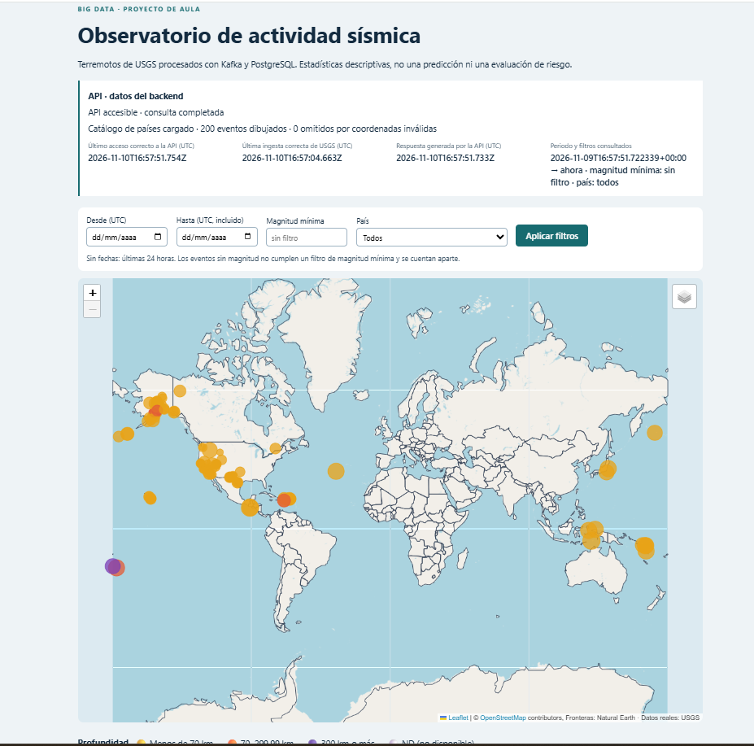
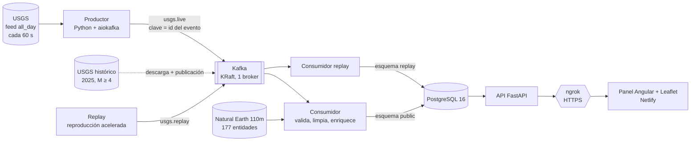
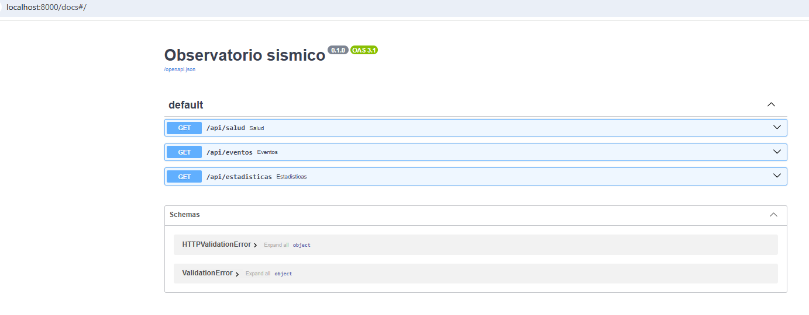
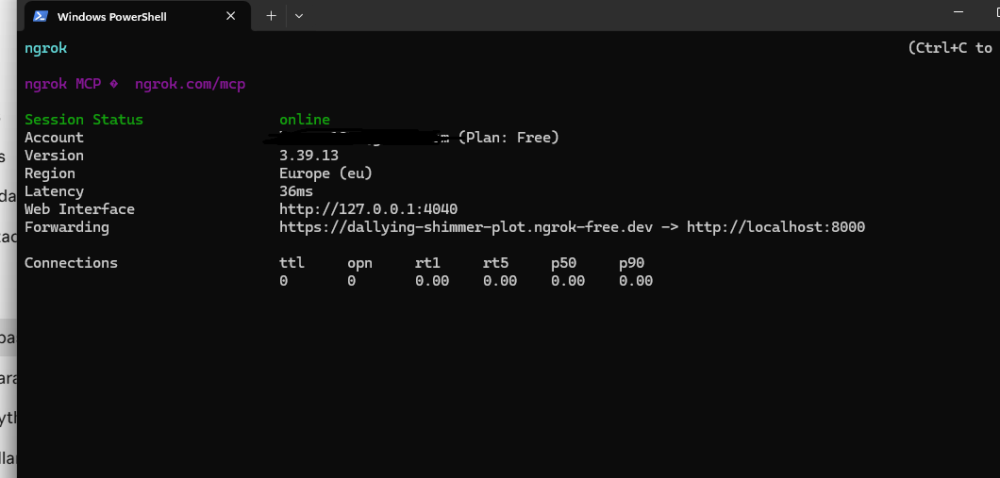
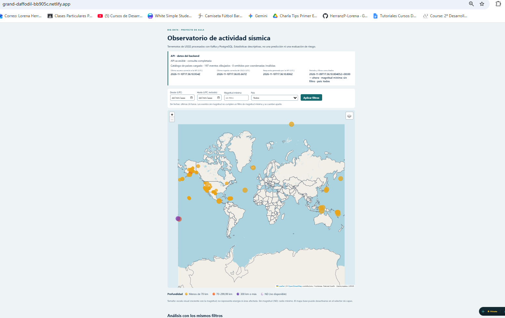
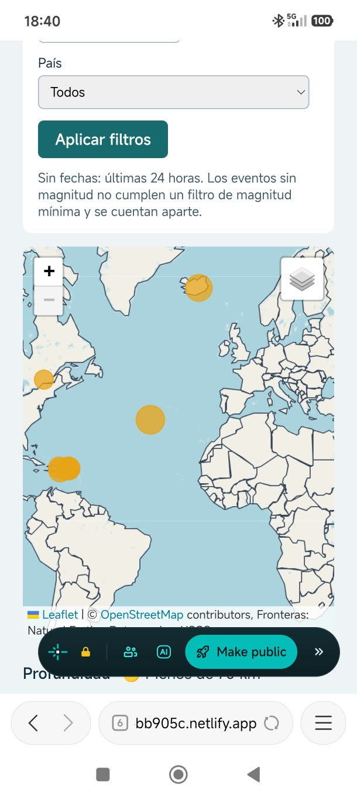
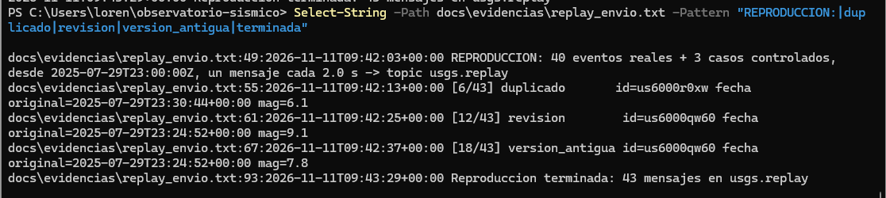
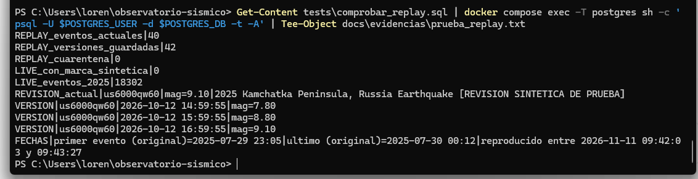
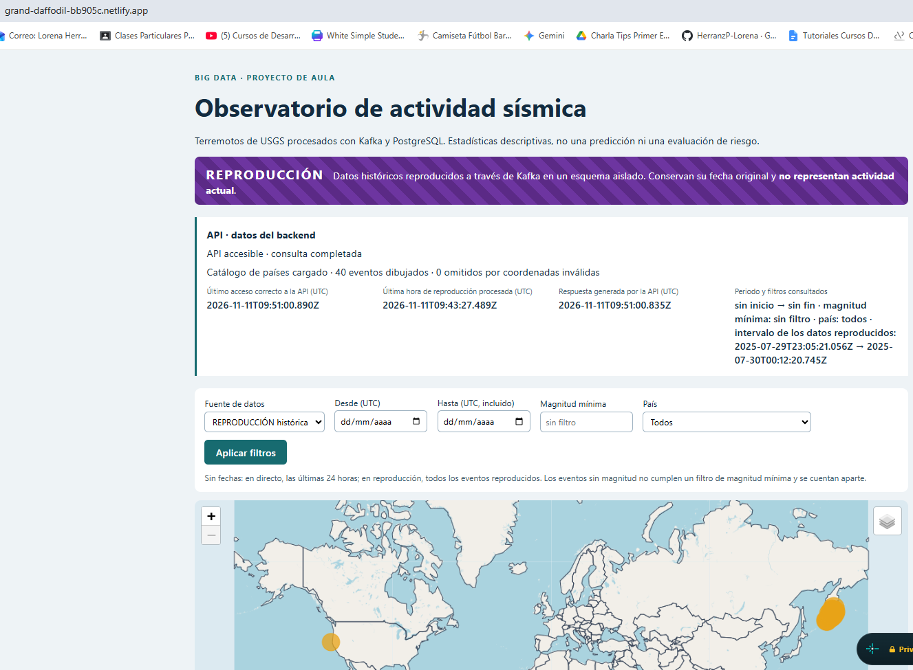
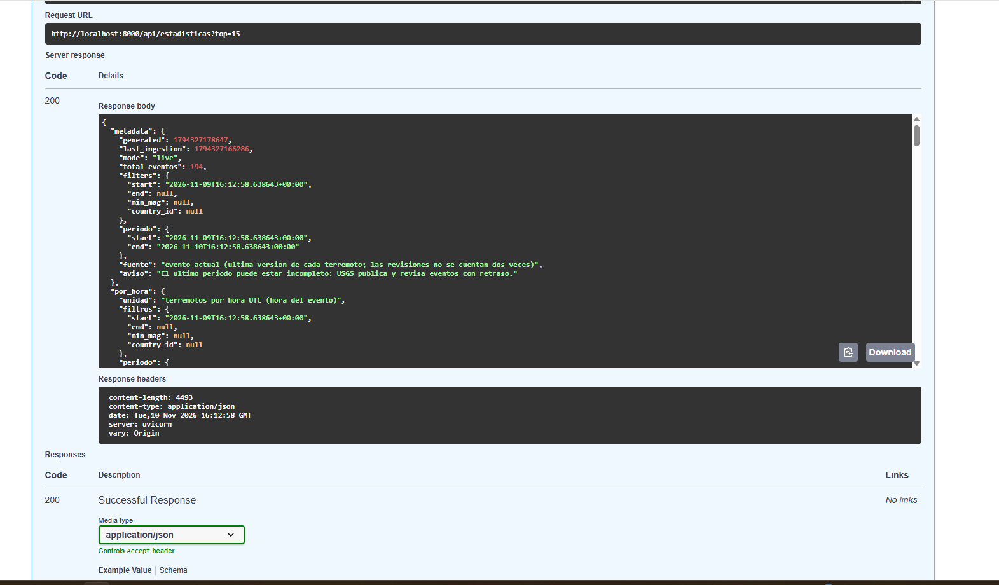

# Observatorio de actividad sísmica

Sistema de Big Data que recoge terremotos de USGS, los procesa con **Kafka** y **PostgreSQL**, los expone con **FastAPI** a través de **ngrok** y los muestra en un panel **Angular + Leaflet** publicado en **Netlify**. Responde a la pregunta: *¿dónde se está registrando actividad sísmica y cómo se compara con un periodo histórico equivalente?*

> Proyecto de la asignatura Sistemas de Big Data (sesión 8, RA1). Son estadísticas descriptivas: **no** son una predicción de terremotos ni una evaluación de riesgo.

| | |
|---|---|
| **Panel (Netlify)** | https://grand-daffodil-bb905c.netlify.app/ |
| **Vídeo de la explicación** | [Ver el vídeo en YouTube](https://youtu.be/GV37aoBFH1g) |
| **Memoria** | [`docs/memoria.md`](docs/memoria.md) |
| **Modelo de datos, diccionario y procedencia** | [`docs/modelo-datos.md`](docs/modelo-datos.md) |

> **El panel necesita que mi equipo esté encendido con los contenedores y el túnel activos.** Netlify solo sirve la interfaz; los datos salen de mi PostgreSQL a través de ngrok. Si están apagados, el panel lo indica con un aviso y conserva la última lectura (esto se probó, ver [pruebas de aceptación](#pruebas-de-aceptación)).



---

## Índice

1. [Arquitectura](#arquitectura)
2. [Puesta en marcha](#puesta-en-marcha)
3. [Túnel ngrok y panel](#túnel-ngrok-y-panel)
4. [Cargar el histórico de 2025](#cargar-el-histórico-de-2025)
5. [Reproducción histórica](#reproducción-histórica)
6. [API](#api)
7. [Estructura del repositorio](#estructura-del-repositorio)
8. [Pruebas de aceptación](#pruebas-de-aceptación)
9. [Resultados](#resultados)
10. [Decisiones técnicas](#decisiones-técnicas)
11. [Limitaciones conocidas](#limitaciones-conocidas)
12. [Uso de IA](#uso-de-ia)

---

## Arquitectura



| Servicio (Docker Compose) | Tecnología | Qué hace |
|---|---|---|
| `producer` | Python + aiokafka | Consulta USGS cada 60 s; publica en Kafka solo lo **nuevo o revisado** (compara `id` y `updated` con el estado guardado); reintentos con espera progresiva |
| `kafka` | Apache Kafka 4.3 (KRaft) | Transporte y retención de 24 h. Topics `usgs.live` (3 particiones) y `usgs.replay` (1) |
| `consumer` | Python + aiokafka | Valida, convierte fechas a UTC, asigna país (punto en polígono) y escribe en PostgreSQL de forma **idempotente**; confirma el offset **después** de la transacción |
| `postgres` | PostgreSQL 16 | Datos preparados, versiones originales, cuarentena y estado de ingesta |
| `api` | Python + FastAPI | Consulta de datos ya procesados. Es el único servicio expuesto (`127.0.0.1:8000`) |
| `kafka-init` | Kafka (un solo uso) | Auxiliar: crea los topics si no existen y termina. No es uno de los cinco servicios del sistema |

Los cinco servicios del sistema tienen `restart: unless-stopped`; PostgreSQL, Kafka y la API tienen comprobación de salud, y los servicios que los necesitan esperan con `depends_on: condition: service_healthy` (productor y consumidor esperan además a que `kafka-init` termine bien). Kafka y PostgreSQL **no** se publican por el túnel.

---

## Puesta en marcha

**Requisitos:** Docker Desktop con Compose v2. (Para el panel en local: Node 22.12 o superior de la rama 22, o 24.x.)

```powershell
# 1) Clonar
git clone https://github.com/HerranzP-Lorena/observatorio-sismico.git
cd observatorio-sismico

# 2) Crear el fichero de variables y poner una contraseña propia (.env no se sube a Git)
Copy-Item .env.example .env
notepad .env

# 3) Levantar todo
docker compose up --build -d

# 4) Comprobar: kafka-init termina con "Exited (0)"; postgres, kafka y api quedan "healthy"
docker compose ps -a
```

Variables (`.env.example`):

| Variable | Significado |
|---|---|
| `POSTGRES_USER` | Usuario de PostgreSQL (`sismo`) |
| `POSTGRES_PASSWORD` | Contraseña (**cámbiala**; el valor de ejemplo no es real) |
| `POSTGRES_DB` | Base de datos (`sismologia`) |

Los datos persisten en dos volúmenes (`pgdata` y `kafka-data`). `docker compose down` **conserva** los datos; `docker compose down -v` los **borra**.

Comprobación rápida de que funciona:

```powershell
curl.exe http://127.0.0.1:8000/api/salud
```

Respuesta esperada: `{"status":"ok","database":"ok",...}`. La documentación interactiva de la API está en http://127.0.0.1:8000/docs.



---

## Túnel ngrok y panel

El panel (Netlify) se conecta a la API a través de un túnel HTTPS de **ngrok** que apunta al puerto 8000 del equipo.

```powershell
# Una sola vez: guardar tu authtoken de ngrok en TU equipo (es una contraseña: nunca en Git ni en Angular)
ngrok config add-authtoken <TU_TOKEN>

# Abrir el túnel (dominio estático de mi cuenta; el tuyo será otro)
ngrok http 8000 --url https://dallying-shimmer-plot.ngrok-free.dev
```



- La URL del túnel va en `frontend/public/config.json` (`apiUrl`) **antes** de compilar el panel. Contiene `"skipNgrokWarning": true` para que el navegador envíe la cabecera `ngrok-skip-browser-warning`.
- La API autoriza por CORS solo los orígenes exactos de Netlify y de desarrollo (`CORS_ORIGINS` en `compose.yaml`). CORS no es autenticación.
- **Panel en local** (opcional): `cd frontend`, `npm ci`, `npm start` y abrir http://localhost:4200.
- **Netlify:** el sitio se construye desde este repositorio con el `netlify.toml` incluido (fija Node 22).

| Panel en Netlify | Desde el móvil con datos móviles |
|---|---|
|  |  |

---

## Cargar el histórico de 2025

Un año completo (2025, mundial, magnitud ≥ 4, `eventtype=earthquake`) en 12 consultas mensuales. Se descarga **una vez** y se reutiliza.

```powershell
docker compose -f compose.yaml -f compose.tools.yaml run --rm historico python /historico/historico.py descargar
docker compose -f compose.yaml -f compose.tools.yaml run --rm historico python /historico/historico.py publicar
```

- `descargar` guarda los ficheros en `historico/datos/` (**no van a Git**) y escribe `historico/manifest_2025.json` (consultas, fecha de extracción, nº de registros y huella SHA-256 de cada fichero), y registra las consultas en `ingesta_consulta`.
- `publicar` envía los eventos a Kafka ordenados por fecha; el consumidor los escribe como al resto.
- Resultado: **18.302 eventos**, 0 duplicados entre intervalos. Evidencia: [`docs/evidencias/carga_historico_2025.txt`](docs/evidencias/carga_historico_2025.txt).

**Si el sistema estuvo parado más de 24 horas:** el feed `all_day` solo cubre las últimas 24 h. El hueco se recupera pidiendo al catálogo histórico el intervalo perdido (misma descarga por fechas) y publicándolo por el mismo camino; las claves y el *upsert* impiden duplicados.

---

## Reproducción histórica

Para demostrar el sistema aunque no haya actividad reciente: se reproduce a velocidad acelerada una selección histórica (por defecto, desde el terremoto de Kamchatka de julio de 2025) por un **topic y un esquema de PostgreSQL aparte** (`usgs.replay` y esquema `replay`). Nunca se mezcla con los datos reales.

```powershell
# Consumidor de reproducción (esquema replay)
docker compose -f compose.yaml -f compose.replay.yaml up -d --build consumer-replay
# Enviar la reproducción (40 eventos reales + 3 casos controlados)
docker compose -f compose.yaml -f compose.replay.yaml run --rm -T replay
```

Incluye tres **casos sintéticos, etiquetados como tales** (campo `replay_case` y texto en `place`): un duplicado, una revisión posterior y una versión antigua que llega tarde. En el panel se elige «REPRODUCCIÓN histórica» en *Fuente de datos* y aparece un aviso grande: lo que se ve no es actividad actual.

| Envío por Kafka | Resultado en la base | Panel |
|---|---|---|
|  |  |  |

> La revisión sintética modifica una copia del evento real de Kamchatka (magnitud 8,8 → 9,1) **solo en el esquema `replay`**. Es un caso de prueba, no un dato real.

---

## API

| Ruta | Para qué |
|---|---|
| `GET /api/salud` | Estado de la API y la base de datos; momento de la última ingesta. Devuelve **503** explícito si la base falla |
| `GET /api/eventos` | Eventos para el mapa y la tabla. Parámetros: `start`, `end`, `min_mag`, `country_id` (`NONE` = sin país), `source` (`live` o `replay`), `limit`, `offset` |
| `GET /api/estadisticas` | Agregaciones con los **mismos filtros**: por hora UTC, por país, distribución de magnitud y de profundidad, comparación histórica (últimas 24 h frente a la media diaria de 2025) |

- Sin `start` ni `end`: últimas 24 h (en `live`); en `replay`, todos los eventos reproducidos.
- Las agregaciones se calculan desde la tabla de **estado actual**: una revisión de USGS nunca cuenta dos veces.
- Los nulos no se rellenan con ceros: se informan aparte (`sin_valor`) y en el panel aparecen como **ND**.
- El denominador histórico incluye los días con cero eventos (365 días).



---

## Estructura del repositorio

```text
observatorio-sismico/
├── compose.yaml              # los servicios del sistema (+ kafka-init)
├── compose.replay.yaml       # consumidor y emisor de la reproducción histórica
├── compose.tools.yaml        # herramienta de descarga del histórico
├── .env.example              # plantilla de variables (sin credenciales reales)
├── producer/                 # productor (Dockerfile, producer.py, requirements.txt)
├── consumer/                 # consumidor (validación, país, escritura idempotente)
├── api/                      # FastAPI
├── db/init/                  # SQL de inicialización de la base
├── historico/                # descarga y reproducción del histórico (+ manifest_2025.json)
├── frontend/                 # Angular + Leaflet (config.json, netlify.toml, catálogo de países)
├── bench/                    # mediciones: rendimiento, costes, calidad y análisis
├── tests/                    # pruebas de aceptación (envío de mensajes, SQL, reinicio)
├── data/                     # exploración inicial de USGS y del catálogo
└── docs/
    ├── memoria.md            # memoria del proyecto
    ├── ENUNCIADO.md, CONTRATO-API.md, FUENTES-Y-LICENCIAS.md, ...   # material entregado por el profesorado
    ├── modelo-datos.md       # modelo, diccionario, índices y procedencia
    ├── evidencias/           # salidas de texto de cada prueba y medición
    └── img/                  # capturas
```

No se incluyen `node_modules`, credenciales, volúmenes ni los ficheros descargados del histórico (se regeneran con el procedimiento anterior).

---

## Pruebas de aceptación

Los casos dañados o artificiales usan ids `test-…` con fecha ficticia (15 de enero de 2026) y se borran al terminar: **no hay eventos sintéticos en las tablas reales** (comprobado: 0 filas `test-%`).

| Prueba | Resultado | Evidencia |
|---|---|---|
| Evento nuevo | Una fila actual, visible en API, mapa y análisis | [`pruebas_basicas.txt`](docs/evidencias/pruebas_basicas.txt) · [`panel-completo-1.png`](docs/img/panel-completo-1.png) |
| Reenviar la misma versión | No aumenta el número de terremotos | [`pruebas_basicas.txt`](docs/evidencias/pruebas_basicas.txt) · [`prueba-reglas-version-sql.png`](docs/img/prueba-reglas-version-sql.png) |
| Versión posterior | Cambian los datos actuales (mag 4,2 → 4,6) y se conserva la anterior | [`pruebas_basicas.txt`](docs/evidencias/pruebas_basicas.txt) |
| Después, una versión antigua | No sustituye a la más reciente | [`pruebas_basicas.txt`](docs/evidencias/pruebas_basicas.txt) · [`prueba_replay.txt`](docs/evidencias/prueba_replay.txt) |
| Magnitud nula | Se conserva como nula (se muestra ND) | [`pruebas_basicas.txt`](docs/evidencias/pruebas_basicas.txt) |
| Coordenadas inválidas | Cuarentena con motivo; no aparece ningún punto | [`pruebas_basicas.txt`](docs/evidencias/pruebas_basicas.txt) |
| Evento marítimo | «Sin país asignado» y permanece en el análisis | [`pruebas_basicas.txt`](docs/evidencias/pruebas_basicas.txt) · [`analisis_2025.md`](docs/evidencias/analisis_2025.md) |
| Reiniciar el consumidor | Reanuda sin duplicar; LAG 0 | [`prueba_reinicio_completa.txt`](docs/evidencias/prueba_reinicio_completa.txt) · [`prueba-reinicio-consumidor.png`](docs/img/prueba-reinicio-consumidor.png) |
| Cerrar el túnel | El panel muestra el fallo y conserva la última lectura | [`tunel-cerrado-aviso.png`](docs/img/tunel-cerrado-aviso.png) |
| Volver a abrir el túnel | Se recupera automáticamente | [`tunel-reabierto-recuperado.png`](docs/img/tunel-reabierto-recuperado.png) |
| Reproducción histórica | Procesa por Kafka sin mezclarse con los datos en vivo | [`replay_envio.txt`](docs/evidencias/replay_envio.txt) · [`prueba_replay.txt`](docs/evidencias/prueba_replay.txt) · [`panel-reproduccion1.png`](docs/img/panel-reproduccion1.png) |
| Arranque desde cero | Clon limpio del repositorio: 6 servicios, 177 países y 182 eventos en menos de 2 minutos | [`arranque_desde_cero.txt`](docs/evidencias/arranque_desde_cero.txt) · [`arranque-desde-cero.png`](docs/img/arranque-desde-cero.png) |
| Filtros del panel (Kamchatka) | 1.315 eventos entre el 29 de julio y el 1 de agosto de 2025, con el panel desplegado en Netlify | [`panel-filtros-kamchatka-1.png`](docs/img/panel-filtros-kamchatka-1.png) · [`panel-filtros-kamchatka-2.png`](docs/img/panel-filtros-kamchatka-2.png) |
| Funcionamiento continuo 24 h | 25 h seguidas sin reinicios de servicios ni suspensiones del equipo; `api`, `kafka` y `postgres` en `healthy`; la API responde por el túnel | [`prueba_24h_inicio.txt`](docs/evidencias/prueba_24h_inicio.txt) · [`prueba_24h_fin.txt`](docs/evidencias/prueba_24h_fin.txt) · [`prueba-24h-inicio.png`](docs/img/prueba-24h-inicio.png) · [`prueba-24h-fin.png`](docs/img/prueba-24h-fin.png) |
| Contraste con USGS (ventana de 24 h) | 0 eventos de USGS ausentes en la base (186 de 186). La base tiene 6 de más (3 %): 1 eliminado por USGS y 5 con un duplicado de otra red | [`prueba_24h_diagnostico_ids.txt`](docs/evidencias/prueba_24h_diagnostico_ids.txt) · [`prueba_24h_gemelos.txt`](docs/evidencias/prueba_24h_gemelos.txt) · [`prueba_24h_eliminados_usgs.txt`](docs/evidencias/prueba_24h_eliminados_usgs.txt) · [`prueba-24h-diagnostico.png`](docs/img/prueba-24h-diagnostico.png) |

Además: el panel muestra un 503 explícito cuando falla la base de datos y se recupera solo ([`api-salud-503-y-recuperacion.png`](docs/img/api-salud-503-y-recuperacion.png)).

**Contraste con USGS (ventana de 24 h, del 14 al 15 de noviembre de 2026, comparando identificadores y no solo recuentos):** no falta ningún evento. La base guarda 6 de más (192 frente a 186): uno fue eliminado después por USGS y cinco tienen un duplicado de otra red sísmica en la misma zona y a pocos segundos de diferencia, lo que apunta a que USGS los fusionó. El sistema guarda lo que recibe y no se entera de eliminaciones o fusiones posteriores (ver [limitaciones](#limitaciones-conocidas)).

---

## Resultados

Todo lo siguiente está medido y reproducible con los scripts de [`bench/`](bench/); el detalle y la interpretación están en la [memoria](docs/memoria.md).

**Calidad** ([`calidad_datos.md`](docs/evidencias/calidad_datos.md)) — seis dimensiones sobre 19.287 terremotos (en el momento de la medida): 0 magnitudes inválidas, 0 ids repetidos, 83 terremotos revisados por USGS conservados con su historial, 0 incoherencias entre tablas, 24 registros en cuarentena (voladuras de cantera, explosiones y un *ice quake*; no son terremotos) y un retraso típico de unos 3 minutos con el sistema funcionando de forma continua (muestra pequeña: 5 a 11 eventos; incluye lo que tarda USGS en publicar).

**Análisis de 2025, M ≥ 4** ([`analisis_2025.md`](docs/evidencias/analisis_2025.md)) — 18.302 eventos:
1. **Pico de julio–agosto** (2.684 y 2.222 frente a ~1.300 al mes), concentrado en pocos días: las réplicas del terremoto de Kamchatka. La media diaria (50,1) queda inflada; la mediana (43,0) es más representativa.
2. **La magnitud sigue la ley de Gutenberg-Richter:** unas 11 veces menos terremotos por cada punto de magnitud.
3. **El 74,8 % son superficiales** (< 70 km); solo el 6,0 % supera los 300 km.
4. **El ranking por países está sesgado:** el 78,4 % queda «Sin país asignado» (epicentros marinos con un catálogo de 1:110 m), así que no mide qué país tiene más terremotos.
5. **Los rankings anuales los dominan los enjambres puntuales** (Etiopía: el 79 % de sus eventos, en enero).

**Rendimiento** ([`rendimiento.md`](docs/evidencias/rendimiento.md), datos **sintéticos**, 3 tamaños hasta 1.000.000):

| Operación | Sin atajo | Con atajo |
|---|---|---|
| Buscar por id (1 M) | lista de Python: 8,3 ms · SQL sin índice: 21,8 ms | diccionario: 0,03 µs · SQL con índice: 0,08 ms (×270) |
| Agregación por hora (1 M) | 16,8 ms | 0,96 ms (×17) |
| País de un punto (177 países) | uno a uno: 22–24 µs | STRtree: 25–27 µs: **empate, no mejora** a este tamaño |

**Funcionamiento continuo y contraste con la fuente** ([`prueba_24h_fin.txt`](docs/evidencias/prueba_24h_fin.txt)) — 25 horas seguidas en marcha, sin reinicios ni suspensiones del equipo. En esa misma ventana no faltó ningún evento de USGS; sobraron 6 de 192 (3 %), explicados por una eliminación y cinco duplicados fusionados después por USGS.

**Costes** ([`costes_almacenamiento.md`](docs/evidencias/costes_almacenamiento.md)) — la base completa ocupa 34,7 MB (1.424 bytes por terremoto) y la transferencia de entrada es de unos 209 MB al día (6,3 GB al mes).

---

## Decisiones técnicas

- **Al menos una vez + escritura idempotente** en lugar de transacción distribuida: claves únicas y *upsert* con `WHERE EXCLUDED.updated_utc > evento_actual.updated_utc`.
- **Offset confirmado después de la transacción:** si el consumidor cae, repite el mensaje y no cambia nada.
- **Estado actual separado del historial de versiones:** las agregaciones salen de una fila por terremoto.
- **País por punto en polígono** (Shapely/STRtree), nunca desde el texto `place`; sin país = `NULL`, conservado.
- **Cuarentena con motivo y referencia Kafka** (topic, partición, offset) para lo que no es un terremoto o es inválido.
- **Reproducción aislada** (topic y esquema aparte) para no contaminar los datos reales.
- **Topics creados por `kafka-init`:** la creación automática está desactivada a propósito.

## Limitaciones conocidas

- Sin el equipo, los contenedores y el túnel encendidos no hay datos nuevos en el panel (se evalúa el tratamiento del fallo, no una disponibilidad 24/7).
- Tras una parada de más de 24 h, el hueco hay que recuperarlo con el catálogo histórico (procedimiento documentado, no automático).
- **No se reconcilian los eventos eliminados o fusionados por USGS.** USGS puede eliminar un evento, o quedarse con un solo identificador cuando dos redes registran el mismo terremoto; el sistema no lo detecta. Medido en una ventana de 24 h: 6 de 192 eventos (3 %) estaban en la base y ya no figuraban en USGS. Mejora propuesta: revisar periódicamente los eventos recientes contra USGS (incluyendo los eliminados) y marcar los que desaparecen.
- El catálogo de países es de baja resolución (1:110 m).
- Un solo broker de Kafka y una sola instancia de PostgreSQL: sin alta disponibilidad.
- La API es de solo lectura y sin autenticación; CORS no es autenticación.
- El proyecto Angular de partida (versiones fijadas por el enunciado) arrastra dependencias de desarrollo con avisos de `npm audit`; no se envían al navegador.
- Las cuentas gratuitas de ngrok y Netlify tienen cuotas; se evitan refrescos innecesarios.

---

## Uso de IA

> **Declaración de uso de IA:** durante todo el proyecto he usado **Claude** (Anthropic) como asistente técnico y tutor: me ayudó con la arquitectura, el código y los borradores de la documentación. Yo ejecuté y comprobé cada paso en mi equipo, hice las capturas, tomé las decisiones de alcance y soy responsable de lo entregado. Las cifras proceden de ejecuciones reales (ficheros en `docs/evidencias/`).

## Fuentes y licencias

- **USGS Earthquake Hazards Program** — feed `all_day` y catálogo FDSN. Datos de dominio público; se cita la fuente.
- **Natural Earth** — límites de países (1:110 m). Dominio público. Fuente, licencia y huella en [`docs/FUENTES-Y-LICENCIAS.md`](docs/FUENTES-Y-LICENCIAS.md).
- Mapa base: teselas de OpenStreetMap a través de Leaflet (atribución visible en el mapa).
