# Memoria — Observatorio de actividad sísmica

Sistemas de Big Data · RA1 · Sesión 8

Esta memoria documenta el proyecto y enlaza cada afirmación con su evidencia en el repositorio (`docs/evidencias/` para salidas de texto y `docs/img/` para capturas). Las cifras proceden de ejecuciones reales en mi equipo; lo que es una **suposición** o una **estimación** se indica como tal.

Documentos relacionados: [README](../README.md) · [Modelo de datos, diccionario y procedencia](modelo-datos.md).

## Índice

1. [Objetivo y alcance](#1-objetivo-y-alcance)
2. [Extracción](#2-extracción)
3. [Calidad de datos](#3-calidad-de-datos)
4. [Integración y modelado](#4-integración-y-modelado)
5. [Análisis y conclusiones](#5-análisis-y-conclusiones)
6. [Complejidad, rendimiento y mediciones](#6-complejidad-rendimiento-y-mediciones)
7. [Costes](#7-costes)
8. [Pruebas de aceptación](#8-pruebas-de-aceptación)
9. [Reflexión, limitaciones y mejoras](#9-reflexión-limitaciones-y-mejoras)
10. [Una decisión técnica propia](#10-una-decisión-técnica-propia)
11. [Uso de IA](#11-uso-de-ia)

---

## 1. Objetivo y alcance

El sistema responde a: *¿dónde se está registrando actividad sísmica y cómo se compara con un periodo histórico equivalente?*

Combina tres fuentes: el **feed de las últimas 24 h** de USGS, un **histórico de 2025** (mundial, magnitud ≥ 4) y un **catálogo geográfico** (Natural Earth 110m, 177 entidades). El flujo completo es:

`USGS → productor (Python/aiokafka) → Kafka → consumidor (Python/aiokafka) → PostgreSQL → API (FastAPI) → ngrok → panel (Angular + Leaflet en Netlify)`

con cinco servicios separados en Docker Compose (más `kafka-init`, un auxiliar de un solo uso que crea los topics). Es estadística descriptiva: **no** es una predicción de terremotos ni una evaluación de riesgo. Diagrama y puesta en marcha en el [README](../README.md).

Alcance elegido para el histórico: **2025, mundial, magnitud ≥ 4, tipo `earthquake`**, la propuesta del enunciado. Consecuencia: por construcción, el histórico no contiene eventos de magnitud menor de 4, y la comparación con el feed en vivo se hace **con el mismo filtro (M ≥ 4)**.

---

## 2. Extracción

### 2.1 Feed reciente

| Aspecto | Detalle |
|---|---|
| URL | `https://earthquake.usgs.gov/earthquakes/feed/v1.0/summary/all_day.geojson` |
| Naturaleza | Ventana móvil de las **últimas 24 h**, actualizada cada minuto. No es el día natural anterior ni una conexión *push*: cada respuesta **repite toda la ventana** |
| Frecuencia | Cada 60 s (`POLL_SECONDS`) |
| Peso de la respuesta | ≈ 145 KB (medido: 144.875 bytes) |
| Campos usados | `id`, `properties.time`, `properties.updated`, `properties.mag`, `properties.magType`, `properties.type`, `properties.place`, `geometry.coordinates` |
| Unidades | Tiempos en **milisegundos** desde Unix epoch; coordenadas: longitud y latitud en grados (WGS84) y **profundidad en km** |
| Opcionales | Magnitud, tipo de magnitud, lugar y profundidad pueden faltar; se tratan sin inventar valores (ver sección 3) |
| Filtro de tipo | Solo `type == "earthquake"`. Las explosiones, voladuras de cantera y otros eventos se **conservan en cuarentena con el motivo** |

Qué hace el productor con cada respuesta: compara `id` y `updated` de cada evento con el estado guardado (`evento_publicado`) y publica en Kafka **solo lo nuevo o revisado**; espera la confirmación de Kafka (`acks=all`) antes de marcar la versión como publicada. Si el proceso cae entre ambas operaciones, el mensaje puede reenviarse y el consumidor lo tolera.

Gestión de errores: *timeout*, HTTP 429 y 5xx y JSON ilegible se reintentan con espera progresiva (hasta 5 intentos); el error se registra en `ingesta_consulta` **sin borrar el estado válido anterior**. «No aparece en la siguiente ventana» no se interpreta como «USGS lo ha eliminado»: puede haber envejecido más de 24 h.

Medido en mi equipo (registro `ingesta_consulta`, ver [`calidad_datos.md`](evidencias/calidad_datos.md)): 665 consultas entre el 5 y el 11 de noviembre de 2026, **0 con error o estado distinto de 200**, y 10 huecos de más de 5 minutos entre consultas, debidos a que el portátil estuvo apagado o reiniciándose.

Latencia: el retraso entre la hora del terremoto y su llegada a la base es de **unos 3 minutos** cuando el sistema funciona de forma continua (mediana 2,8 min en la ventana de 30 min y en la de 1 h; muestra pequeña, 5 y 11 eventos). Incluye lo que USGS tarda en publicar el evento, que no controlo. Con el equipo apagado, al volver a encenderlo se recuperan los eventos de las últimas 24 h, pero llegan tarde (ver sección 3.5).

### 2.2 Histórico

- Fuente: API de catálogo FDSN de USGS, **12 consultas mensuales** de 2025 con `minmagnitude=4`, `eventtype=earthquake`, `orderby=time-asc`.
- Ninguna consulta superó el máximo de 20.000 resultados, así que no hizo falta subdividir (el procedimiento está previsto en el código y no trunca en silencio).
- Resultado según el manifiesto: **18.302 registros brutos, 18.302 únicos y 0 duplicados entre intervalos**.
- Se descarga **una vez** y se reutiliza; el manifiesto (`historico/manifest_2025.json`) guarda cada consulta, la fecha de extracción, el nº de registros y la huella SHA-256 de cada fichero.
- Es una **instantánea del catálogo en la fecha de extracción**, no un registro de todas las revisiones pasadas.
- Evidencias: [`carga_historico_2025.txt`](evidencias/carga_historico_2025.txt) · 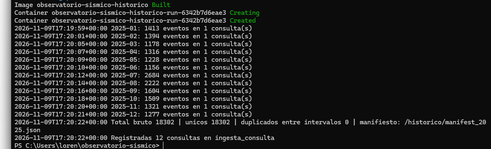 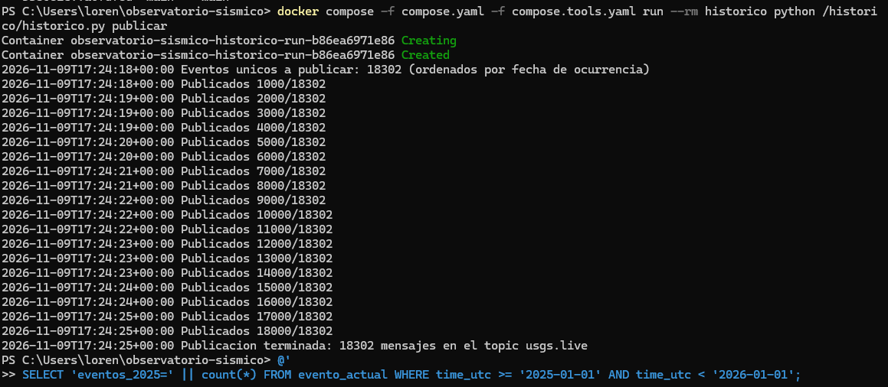 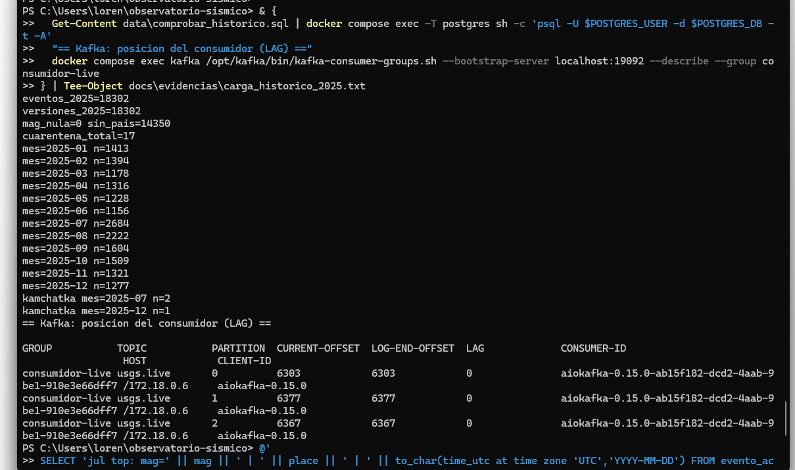

### 2.3 Catálogo geográfico

Natural Earth 110m entregado con el proyecto: 177 entidades (`Polygon`/`MultiPolygon`). Se usa `ADM0_A3` como identificador (se comprobó su unicidad: es la clave primaria de `pais`). Fuente, licencia y huella en [`FUENTES-Y-LICENCIAS.md`](FUENTES-Y-LICENCIAS.md).

### 2.4 Contraste con la fuente

Comprobación de exactitud frente a USGS en una ventana de 24 h (de 2026-11-14 18:00 UTC a 2026-11-15 18:00 UTC), comparando **identificadores** y no solo recuentos (ver [`prueba_24h_fin.txt`](evidencias/prueba_24h_fin.txt) y [`prueba_24h_diagnostico_ids.txt`](evidencias/prueba_24h_diagnostico_ids.txt)):

| | USGS | Base de datos |
|---|---|---|
| Todas las magnitudes | 186 | 192 |
| M ≥ 4 | 18 | 19 |

- **Ausentes en la base: 0.** Todos los eventos de USGS de esa ventana están guardados.
- **De más en la base: 6 (3 %).** Uno aparece como eliminado por USGS ([`prueba_24h_eliminados_usgs.txt`](evidencias/prueba_24h_eliminados_usgs.txt)). Los otros cinco tienen un «gemelo» en la propia base (otra red sísmica, como máximo unos segundos de diferencia y en la misma zona; [`prueba_24h_gemelos.txt`](evidencias/prueba_24h_gemelos.txt)), lo que apunta a duplicados que USGS fusionó después. Esto último es una inferencia a partir de los datos, no una confirmación de USGS.
- La hipótesis inicial (que la base guardara tipos de evento que el recuento de USGS excluye) **no se sostuvo**: USGS da las mismas cifras con y sin filtro de tipo (18 y 186), y los eventos que no son terremotos ya se apartan a cuarentena.

El sistema guarda lo que recibe y no se entera de eliminaciones o fusiones posteriores (ver sección 9).

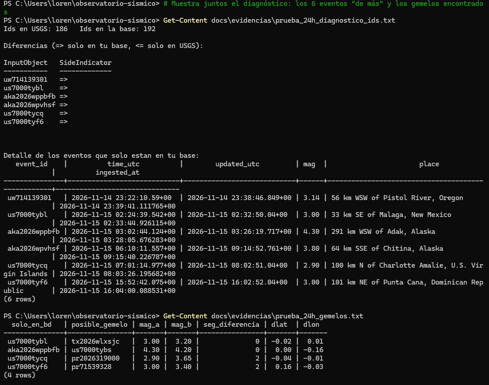

---

## 3. Calidad de datos

Informe medido sobre la base real con `bench/calidad.py` (solo lectura). Salida completa: [`calidad_datos.md`](evidencias/calidad_datos.md). Base de 19.287 terremotos en el momento de la medida.

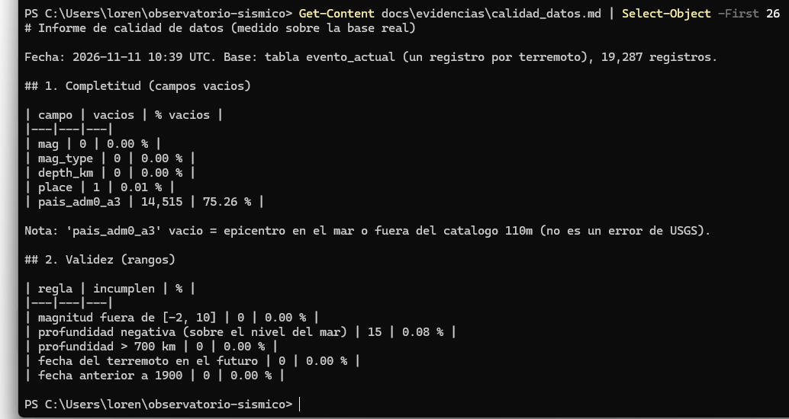
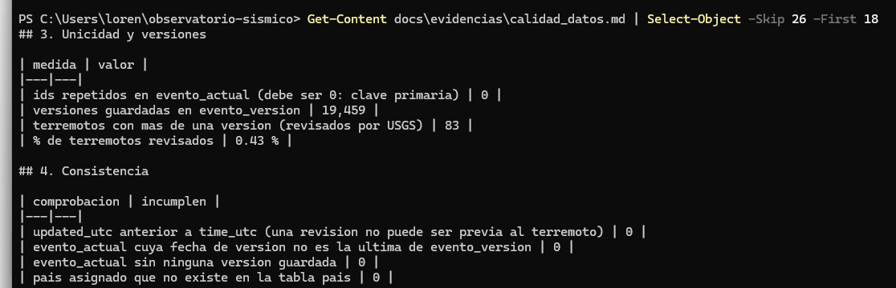
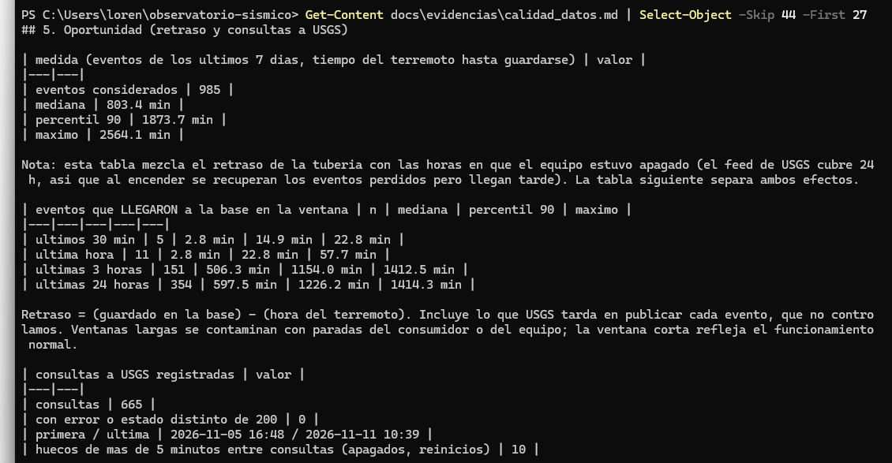
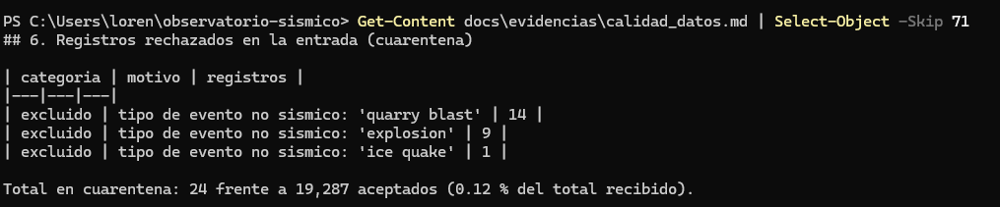

### 3.1 Completitud

| Campo | Vacíos | % |
|---|---|---|
| `mag` | 0 | 0,00 % |
| `mag_type` | 0 | 0,00 % |
| `depth_km` | 0 | 0,00 % |
| `place` | 1 | 0,01 % |
| `pais_adm0_a3` | 14.515 | **75,26 %** |

El 75,26 % sin país **no es un error de USGS**: son epicentros en el mar o fuera de los polígonos de un catálogo de baja resolución (1:110 m). Se conserva como «Sin país asignado» y no se atribuye al país más cercano. Aviso: el 0 % de magnitudes vacías es en parte consecuencia del filtro `minmagnitude=4` del histórico; en el feed en vivo (todas las magnitudes) pueden aparecer nulos, que se **conservan como nulos** (se muestran como ND) y nunca se sustituyen por cero.

### 3.2 Validez

| Regla | Incumplen |
|---|---|
| Magnitud fuera de [−2, 10] | 0 |
| Profundidad > 700 km | 0 |
| Fecha en el futuro / anterior a 1900 | 0 / 0 |
| **Profundidad negativa** | **15 (0,08 %)** |

Las 15 profundidades negativas **no se rechazan**: significan un foco por encima del nivel del mar, algo que USGS permite. Una magnitud negativa tampoco es un error. Las reglas de validación del consumidor (tipos, fechas parseables, coordenadas finitas y en rango, geometría `Point`) están en la sección 5.3 de [`modelo-datos.md`](modelo-datos.md).

### 3.3 Unicidad

0 ids repetidos en el estado actual (clave primaria). Hay **83 terremotos con más de una versión** (0,43 %): USGS los revisó y se conserva el historial completo en `evento_version` (19.459 versiones en total).

### 3.4 Consistencia

Cuatro comprobaciones, todas con **0 incumplimientos**: ninguna revisión es anterior al terremoto; la fecha de `evento_actual` coincide con la última de `evento_version`; no hay estados actuales sin versión; no hay países asignados que no existan en el catálogo.

### 3.5 Actualidad

La mediana global del retraso de los eventos de los últimos 7 días es de **803 min**, pero **no** mide la tubería: mezcla las horas en que mi portátil estuvo apagado y al encenderlo se recuperaron las 24 h anteriores. Mirando solo lo que llegó en la última media hora o la última hora, la mediana es de **2,8 min**. Mi primera versión de esta medida (con un filtro por huecos de consulta) no separaba bien los efectos, porque el consumidor también puede estar parado mientras el productor sigue consultando; los eventos esperan entonces en Kafka y se guardan de golpe. Lo corregí midiendo por **ventana de llegada**. El máximo de la ventana de 24 h (1.414 min = 23,6 h) queda justo por debajo de las 24 h que cubre el feed, coherente con la recuperación tras un apagado y con que no se perdió ningún evento.

### 3.6 Exactitud

Lo que puede contrastarse: los eventos frente a USGS (en una ventana de 24 h, ninguno ausente y 6 de más, 3 %; ver sección 2.4) y la asignación de países frente al texto que USGS escribe en `place`: coincide en Etiopía 263 de 265, Chile 335 de 348, Indonesia 300 de 306 y Argentina 226 de 236 (96–99 %). En China solo 197 de 354; **no he investigado la causa**. Lo que no puede contrastarse: la magnitud real (depende del método de cada red: `magType`) y los eventos que el catálogo no detecta (la cobertura varía por región y magnitud).

### 3.7 Registros rechazados (antes y después)

| | Registros |
|---|---|
| Aceptados (estado actual) | 19.287 |
| En cuarentena | 24 (0,12 % del total recibido) |

Desglose de la cuarentena: **14 voladuras de cantera, 9 explosiones y 1 *ice quake***. No son terremotos; se conservan con su motivo y su original (JSON completo y referencia Kafka: topic, partición, offset). Ninguno se rechazó por datos corruptos. Los casos artificialmente dañados de las pruebas (`test-…`) quedan **separados e identificados**: se borraron al terminar (0 filas `test-%` en las tablas reales).

### 3.8 Transformaciones y su alcance

| Transformación | Registros afectados |
|---|---|
| Fechas de milisegundos Unix a UTC con zona horaria | Todos |
| Separar tiempo de ocurrencia (`time_utc`), revisión (`updated_utc`) e ingesta (`ingested_at`) | Todos |
| Asignar país por punto en polígono | 4.772 con país; 14.515 «Sin país asignado» |
| Conservar el JSON original (`evento_version.original`) | Todos |
| Excluir tipos no sísmicos | 24 |
| Rellenar nulos | **Ninguno** (no se sustituyen por cero) |

### 3.9 Acciones propuestas

- Sustituir el catálogo 1:110 m por uno más detallado (1:10 m), o añadir zonas marítimas, para reducir el 75 % sin país.
- Alertar cuando pase demasiado tiempo sin una consulta correcta (hoy solo se ve en el panel y en `ingesta_consulta`).
- Registrar la hora de cada consulta junto a cada evento nuevo para medir la latencia de forma directa, sin depender de ventanas de llegada.

---

## 4. Integración y modelado

Detalle completo en [`modelo-datos.md`](modelo-datos.md): modelo conceptual, lógico (diagrama), físico (SQL), grano y claves, diccionario de datos y justificación de índices. Resumen:

- **`evento_actual`**: una fila por `event_id`. Es la tabla de las agregaciones, de modo que una revisión nunca cuenta dos veces.
- **`evento_version`**: una fila por `(event_id, updated_utc)`, con el original en JSONB.
- **`pais`** (dimensión del catálogo) y «Sin país asignado» como `NULL`.
- **`ingesta_consulta`, `cuarentena`, `evento_publicado`**: estado de ingesta, rechazos y última versión publicada.
- **Integración geográfica:** punto en polígono con Shapely/STRtree sobre WGS84; con varias coincidencias (frontera) gana el menor `ADM0_A3`.
- **Escritura idempotente:** `INSERT … ON CONFLICT DO NOTHING` para las versiones y *upsert* del estado actual **solo si `updated_utc` es más reciente**, en una transacción; el offset de Kafka se confirma después. Procesamiento al menos una vez, sin transacción distribuida.
- **Optimización:** índices por `time_utc`, `pais_adm0_a3` y `mag`; la justificación y lo medido (y lo no medido) está en el documento del modelo.

---

## 5. Análisis y conclusiones

Datos: 18.302 terremotos de **2025, mundial, M ≥ 4, tipo `earthquake`** (filtros iguales en toda la comparación). Salida completa y consultas: [`analisis_2025.md`](evidencias/analisis_2025.md) (script `bench/analisis.py`).

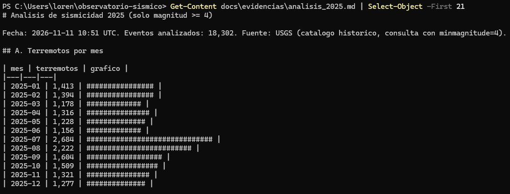
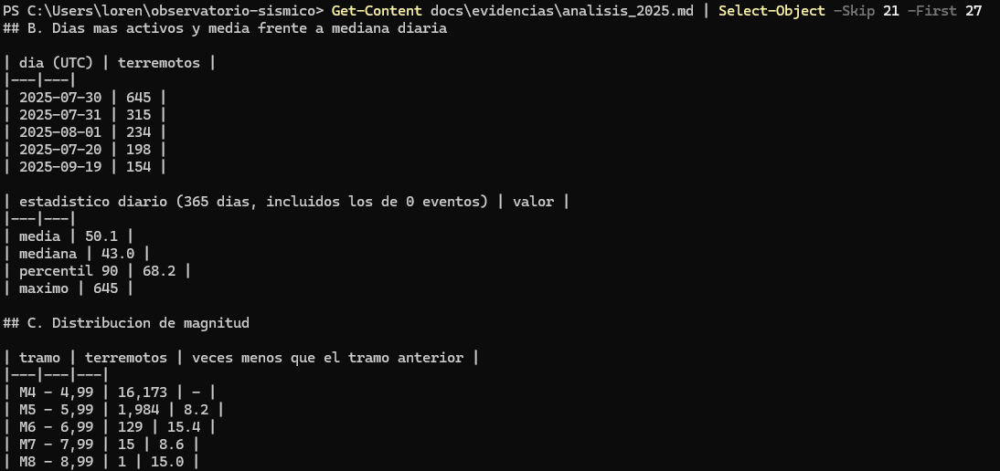
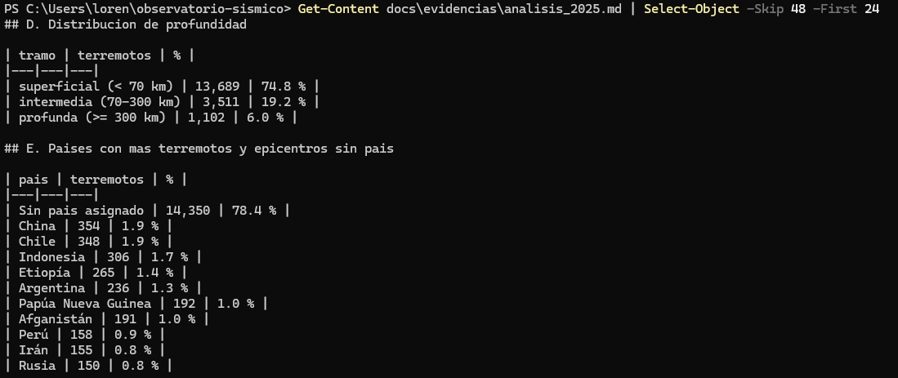
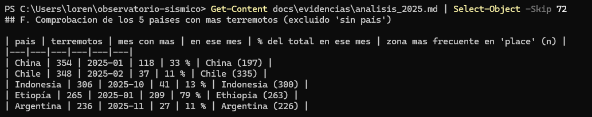

### Conclusión 1 — La actividad no es uniforme: pico en julio y agosto de 2025

Julio tuvo **2.684** terremotos y agosto **2.222**, frente a unos 1.200–1.400 en un mes normal (el resto de meses va de 1.156 a 1.604). El 30 de julio hubo **645** en un solo día, y los dos días siguientes (315 y 234) también están entre los más activos. Esto cuadra con las réplicas del gran terremoto de Kamchatka (ver la investigación en [`julio_2025_investigacion.txt`](evidencias/julio_2025_investigacion.txt)). Consecuencia: la **media diaria (50,1)** queda inflada por el pico y la **mediana (43,0)** representa mejor un día normal; el percentil 90 es 68,2. Al comparar el presente con 2025 conviene dar ambas referencias.

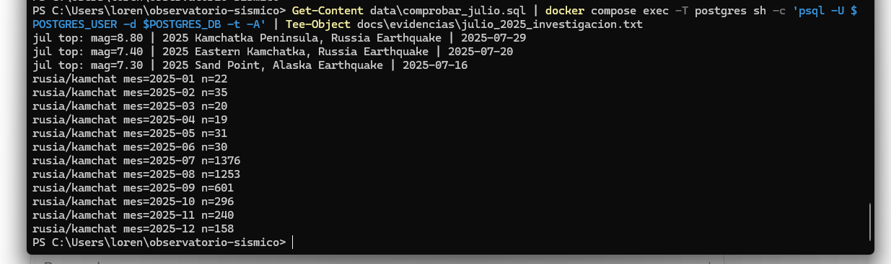

### Conclusión 2 — La magnitud sigue la ley de Gutenberg-Richter

Por cada punto más de magnitud hay unas 10 veces menos terremotos. En los datos: 16.173 (M4) → 1.984 (M5) → 129 (M6) → 15 (M7) → 1 (M8). El factor medio es **11,3** (16.173 frente a 1 en cuatro saltos); los saltos individuales (8,2; 15,4; 8,6; 15,0) fluctúan porque los tramos altos tienen muy pocos eventos. Que M4 → M5 sea 8,2 y no 10 sugiere que el catálogo recoge menos M4 de los que ocurren; es una explicación plausible, **no comprobada**.

### Conclusión 3 — Los terremotos son mayoritariamente superficiales

El **74,8 %** ocurre a menos de 70 km, el 19,2 % entre 70 y 300 km y solo el **6,0 %** a 300 km o más. (13.689, 3.511 y 1.102 eventos; 0 sin profundidad).

### Conclusión 4 — El ranking por países está sesgado por el catálogo

El **78,4 %** de los terremotos de 2025 queda «Sin país asignado» (14.350 de 18.302), porque el epicentro cae en el mar o fuera de polígonos simplificados. Por eso Japón, Tonga o Filipinas, con mucha actividad costera y oceánica, **no aparecen en el top**, mientras que aparecen países de interior (China 354, Chile 348, Indonesia 306, Etiopía 265, Argentina 236). Esa tabla **no mide qué país tiene más terremotos**: mide cuáles caen dentro de sus polígonos.

### Conclusión 5 — Los rankings anuales están dominados por enjambres puntuales

Etiopía tiene el **79 %** de sus 265 terremotos en un solo mes (enero, 209), y China el 33 % en enero. En cambio, Chile (11 %), Indonesia (13 %) y Argentina (11 %) tienen actividad repartida (un reparto uniforme daría un 8 % por mes). Un total anual puede ocultar que casi toda la actividad fue un episodio concreto.

### Comparación histórica en el panel

El panel compara las **últimas 24 h con magnitud ≥ 4** con la **media diaria de 2025 bajo los mismos filtros**, con 365 días en el denominador (incluidos los días con cero eventos). Cuando medí, las últimas 24 h tenían 16 eventos frente a una media de 50,14 al día: un cociente de **0,32**. Con la mediana (43,0) sería 0,37. Aviso: el último periodo puede estar incompleto por retrasos de publicación, y la comparación no es una predicción.

| Filtros en el panel (fecha, magnitud, país) | Gráficos |
|---|---|
| 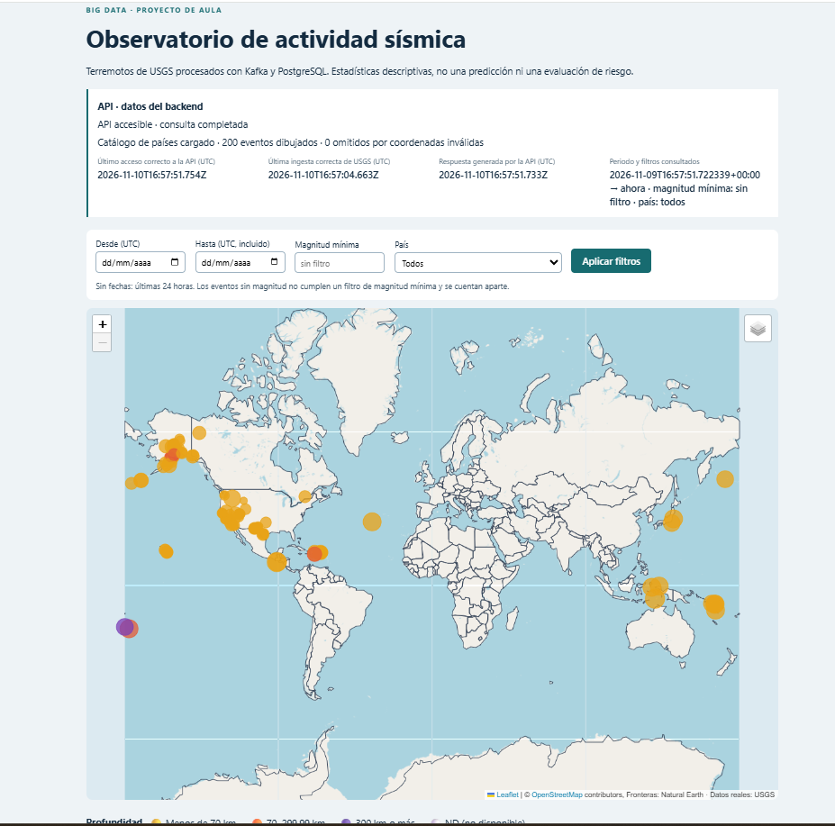 | 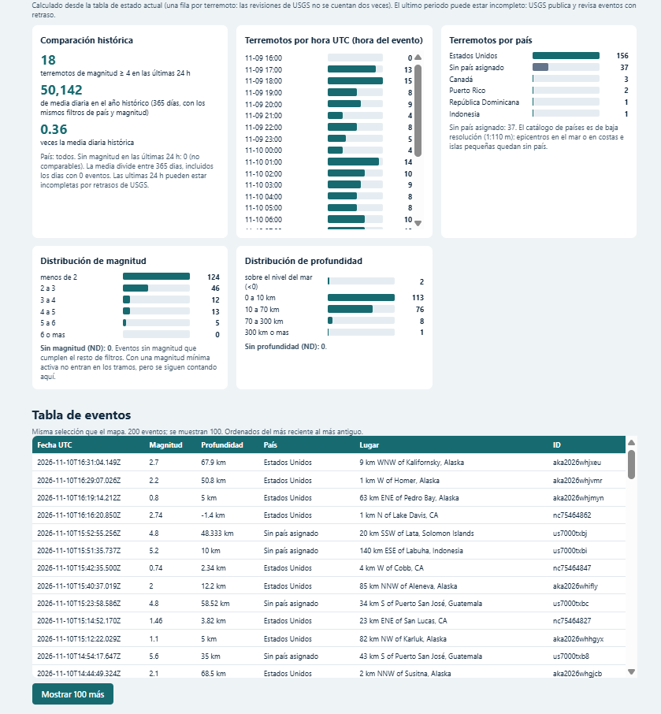 |

Limitación honesta: la cobertura de detección y los tipos de magnitud varían entre regiones y épocas, así que estas estadísticas no son una evaluación de riesgo.

---

## 6. Complejidad, rendimiento y mediciones

Todas las mediciones usan **datos sintéticos** (marcados como tales, en un esquema `bench` que se borra al terminar), fuera del análisis real. Script: `bench/medir.py`; resultado completo: [`rendimiento.md`](evidencias/rendimiento.md).

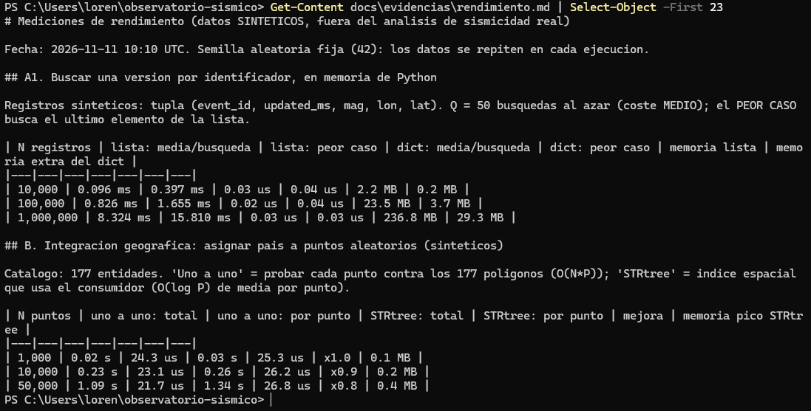
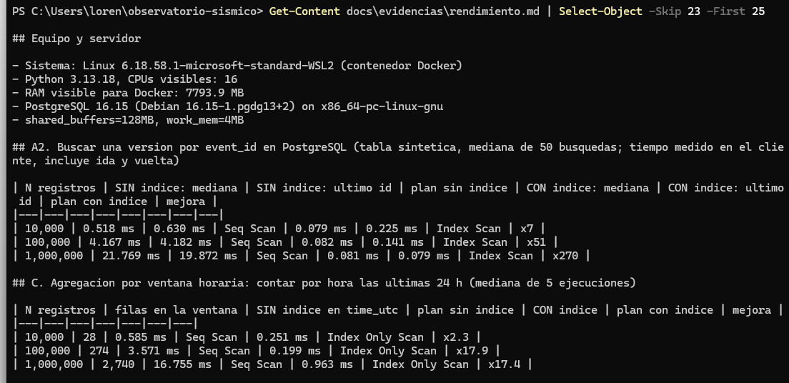
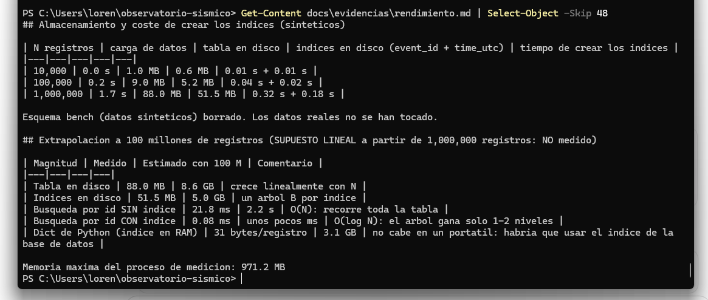

**Equipo y procedimiento.** Portátil con Windows y Docker Desktop (WSL2): 16 CPU visibles, 7,8 GB de RAM para Docker, PostgreSQL 16.15 con `shared_buffers=128MB` y `work_mem=4MB`. Datos con semilla fija (42). Tres tamaños: 10.000, 100.000 y 1.000.000 de registros (50.000 puntos como máximo en la prueba geográfica). Tiempos con `perf_counter`; memoria con `tracemalloc`. Búsquedas: 50 al azar (coste medio: media en Python, mediana en SQL) y búsqueda del último elemento (peor caso).

### 6.1 Búsqueda de una versión por identificador

| N | Lista (media) | Lista (peor caso) | Diccionario | SQL sin índice | SQL con índice |
|---|---|---|---|---|---|
| 10.000 | 0,096 ms | 0,397 ms | 0,03 µs | 0,52 ms | 0,079 ms |
| 100.000 | 0,826 ms | 1,655 ms | 0,02 µs | 4,17 ms | 0,082 ms |
| 1.000.000 | 8,3 ms | 15,8 ms | 0,03 µs | 21,8 ms | 0,081 ms |

- **Lista: O(N)** en media y en el peor caso; el tiempo se multiplica por 10 al multiplicar N por 10. **Diccionario: O(1)** de media (el peor caso teórico es O(N) por colisiones, que no apareció). **SQL con índice (árbol B): O(log N)**: el tiempo casi no cambia con N. Sin índice, PostgreSQL hace un recorrido completo (*Seq Scan*) y, por eso, la media y el «último id» salen iguales (21,8 y 19,9 ms).
- Memoria con 1 M de registros: la lista ocupa **236,8 MB** y el diccionario añade **29,3 MB**.
- Los 0,08 ms con índice son sobre todo el viaje de ida y vuelta al servidor (la medida es del cliente).

### 6.2 Integración geográfica (punto en polígono)

| Puntos | Uno a uno (177 polígonos) | STRtree |
|---|---|---|
| 1.000 | 24,3 µs/punto | 25,3 µs/punto (×1,0) |
| 10.000 | 23,1 µs | 26,2 µs (×0,9) |
| 50.000 | 21,7 µs | 26,8 µs (×0,8) |

**El árbol espacial no mejora a este tamaño.** Con 177 polígonos, probar uno a uno ya es rápido (la librería descarta casi todos de un vistazo) y el árbol no ahorra trabajo. El coste por punto es constante en ambos casos (≈ 22–27 µs): lineal en el nº de puntos. Teóricamente, uno a uno es O(N·P) y el STRtree O(N·log P) de media (O(N·P) en el peor caso); el árbol compensaría con **muchos más polígonos o más complejos** (por ejemplo, regiones administrativas), pero eso es un razonamiento y **no está medido**. Lo mantengo en el consumidor porque escala si el catálogo crece, sabiendo que hoy no aporta velocidad.

### 6.3 Agregación por ventanas horarias

Contar por hora las últimas 24 h:

| N | Filas en la ventana | Sin índice en `time_utc` | Con índice |
|---|---|---|---|
| 10.000 | 28 | 0,585 ms | 0,251 ms (×2,3) |
| 100.000 | 274 | 3,57 ms | 0,199 ms (×17,9) |
| 1.000.000 | 2.740 | 16,8 ms | 0,963 ms (×17,4) |

Sin índice: O(N) (*Seq Scan*). Con índice: O(log N + k) con k filas en la ventana (el plan pasa a *Index Only Scan*). Cuanto menor es la ventana respecto de la tabla, más gana el índice. Nota: esta consulta solo pedía `time_utc` y un recuento; una que lea más columnas no siempre podrá usar *Index Only Scan*.

### 6.4 Almacenamiento

Con 1.000.000 de filas sintéticas: tabla 88,0 MB e índices 51,5 MB; crear los dos índices tardó 0,5 s.

### 6.5 ¿Y con 100 millones de registros?

Estimación **lineal, no medida**:

- **Disco:** con filas sintéticas serían unos 8,6 GB de tabla y 5,0 GB de índices, pero con las **filas reales** (1.424 bytes por terremoto, porque `evento_version` guarda el JSON original) serían **unos 142 GB**. Las pruebas sintéticas dan la forma de las curvas; el tamaño real lo da la fila real.
- **Memoria:** la lista de registros en Python ocuparía ≈ 24 GB (236,8 MB × 100): no cabe en la RAM de mi equipo (7,8 GB). El índice en diccionario añadiría ≈ 3,1 GB solo de claves.
- **Búsqueda por id sin índice:** ≈ 2,2 s por consulta por escalado lineal (21,8 ms × 100), y probablemente **peor**: con 1 M la tabla (88 MB) cabe entera en caché; con 100 M no, y habría que leer del disco.
- **Con índice:** sigue siendo de pocos milisegundos (O(log N), un árbol con uno o dos niveles más).
- **Asignar país:** a ≈ 25 µs por punto, 100 M de puntos serían ≈ 2.500 s (unos 42 min) en un solo proceso.
- **Conclusión:** a esa escala, índice obligatorio, particionar la tabla por mes, no cargar datos en listas de Python, varias particiones de Kafka con varios consumidores y revisar el tamaño de la fila (por ejemplo, guardar el original comprimido o fuera de la tabla caliente).

Limitaciones de las medidas: una sola ejecución por tamaño (sin repetir para estimar variabilidad), caché caliente y tiempos medidos desde el cliente, incluida la ida y vuelta.

---

## 7. Costes

Presento qué está **medido** (M), qué está **calculado** a partir de lo medido (C) y qué es una **suposición** (S).

| Concepto | Valor | Tipo | Cómo |
|---|---|---|---|
| **Hardware** | Portátil de 1.200 €; con 4 años de vida útil, **25 €/mes** si se imputara entero | S (la vida útil) | 1.200 € ÷ 48 meses. Sin compra adicional: el sistema usa el equipo que ya existe |
| **Electricidad, uso real** (solo mientras trabajo) | ≈ **0,7 €/mes** | S | 40 W de media (no medido) × 4 h/día × 30 días = 4,8 kWh × 0,15 €/kWh (precio supuesto) |
| **Electricidad, si fuera un servicio 24/7** | ≈ **4,3 €/mes** | S | 40 W × 720 h = 28,8 kWh × 0,15 €/kWh |
| **Almacenamiento hoy** | **34,7 MB** (base completa) | M | Consulta `pg_database_size` (`bench/medir_costes.py`) |
| **Crecimiento** | ≈ 73 MB/año | C | ≈ 140 eventos/día en vivo (985 eventos de los últimos 7 días, todas las magnitudes) × 1.424 B/evento × 365 |
| **Transferencia de entrada** | **209 MB/día** (6,3 GB/mes) | C | 1.440 consultas/día × 144.875 bytes |
| **Transferencia de salida por visitante con el panel abierto** | ≈ **3,8 MB/hora** (91 MB/día) | C | 63.211 bytes por refresco (58.538 de `/api/eventos` + 4.673 de `/api/estadisticas`) × 60 refrescos/hora, **sin compresión** |
| **Latencia de la API (local)** | 34 ms (`/api/eventos`) y 48 ms (`/api/estadisticas`) | M | `curl` a 127.0.0.1; no incluye ngrok |
| **Mantenimiento** | ≈ 1 h/mes | S | Actualizar imágenes, comprobar el túnel y las cuentas |
| **Tiempo de desarrollo** | ≈ 15 h | S | Estimación de la autora, **no cronometrada** (puede ser mayor); no se monetiza |
| **Servicios externos** | 0 € | — | Cuentas gratuitas de ngrok y Netlify, **dentro de sus cuotas**; una cuota gratuita no equivale a coste total cero |

Valoración: el coste monetario directo es **despreciable** (del orden de 1 a 5 €/mes de electricidad) porque se usa un equipo ya amortizado; el coste dominante es el **tiempo** de desarrollo y mantenimiento. No estimo un ROI porque el observatorio no tiene un beneficio económico medible que pueda justificar con honestidad.

### Propuesta de escalado (sin contratar nada)

1. **Hasta unos millones de eventos:** el diseño actual vale tal cual; el índice por tiempo es lo que mantiene las consultas en milisegundos.
2. **Decenas de millones:** particionar `evento_actual` y `evento_version` por mes, más memoria para PostgreSQL (`shared_buffers`), y aumentar las particiones de Kafka con varios consumidores del mismo grupo.
3. **Disponibilidad real:** un VPS o un servicio gestionado en lugar del portátil (precios sin verificar: habría que consultarlos), un broker de Kafka con réplicas y copias de seguridad de PostgreSQL.
4. **Transferencia:** activar compresión HTTP en la API (reduce el tráfico de salida) y refrescar menos cuando la pestaña no está visible.

---

## 8. Pruebas de aceptación

| Prueba | Resultado | Evidencia |
|---|---|---|
| Recibir un evento nuevo | Una fila actual, visible en API, mapa y análisis | [`pruebas_basicas.txt`](evidencias/pruebas_basicas.txt) · [`panel-completo-1.png`](img/panel-completo-1.png) |
| Reenviar la misma versión | No aumenta el número de terremotos | [`pruebas_basicas.txt`](evidencias/pruebas_basicas.txt) · 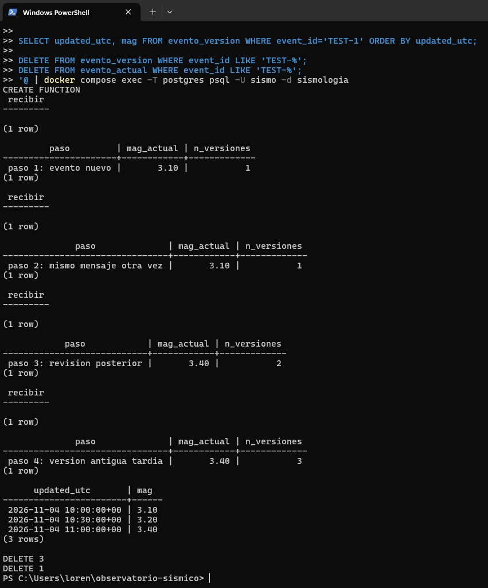 |
| Recibir una versión posterior | Cambian los datos actuales (mag 4,2 → 4,6); la anterior queda en el historial | [`pruebas_basicas.txt`](evidencias/pruebas_basicas.txt) |
| Recibir después una versión antigua | No sustituye a la más reciente | [`pruebas_basicas.txt`](evidencias/pruebas_basicas.txt) · [`prueba_replay.txt`](evidencias/prueba_replay.txt) |
| Magnitud nula | Se conserva como nula (`test-MAGNULA`, mag NULL); el panel está programado para mostrarla como ND (se enseña en el vídeo) | [`pruebas_basicas.txt`](evidencias/pruebas_basicas.txt) |
| Coordenadas inválidas | Cuarentena con motivo (`test-LAT145`, lat = 145); no aparece ningún punto | [`pruebas_basicas.txt`](evidencias/pruebas_basicas.txt) |
| Evento marítimo | «Sin país asignado» (`test-E2`) y permanece en el análisis | [`pruebas_basicas.txt`](evidencias/pruebas_basicas.txt) |
| Reiniciar consumidor | Con el consumidor parado el mensaje espera en Kafka; al arrancar aparece **una** vez; tras otro reinicio sigue en 1; LAG 0 | [`prueba_reinicio_completa.txt`](evidencias/prueba_reinicio_completa.txt) · 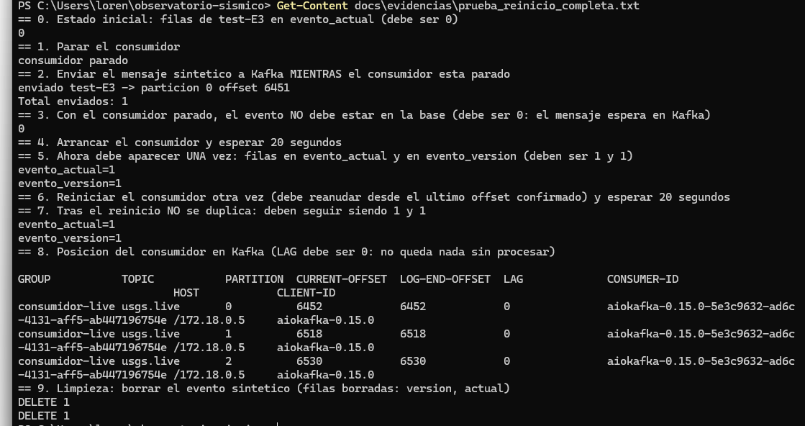 |
| Cerrar el túnel | El panel muestra el fallo y conserva la última lectura | 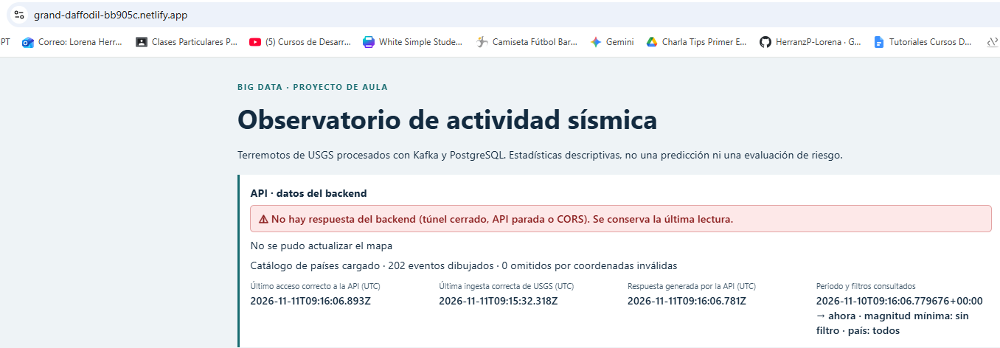 |
| Volver a abrir el túnel | Se recuperan las consultas automáticamente | 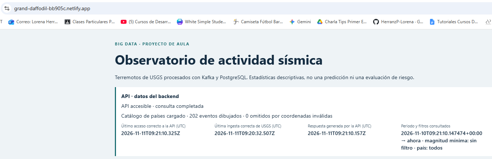 |
| Reproducción histórica | Procesa por Kafka, en topic y esquema aparte, sin mezclarse con lo real; incluye duplicado, revisión y versión antigua | [`replay_envio.txt`](evidencias/replay_envio.txt) · [`prueba_replay.txt`](evidencias/prueba_replay.txt) · 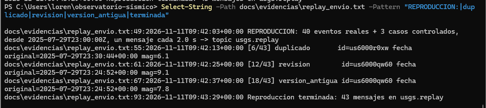 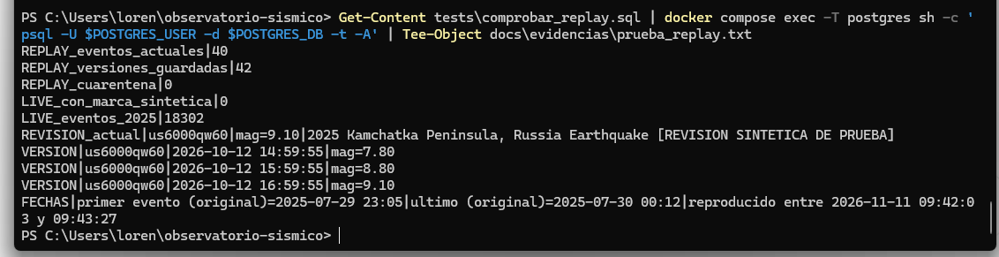 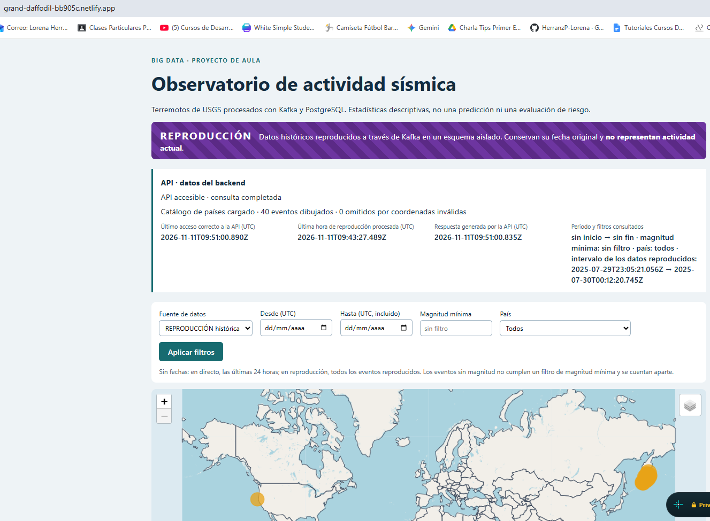 |
| Arranque desde cero | Clon limpio del repositorio: 6 servicios, topics creados por `kafka-init`, 177 países y 182 eventos en menos de 2 minutos | [`arranque_desde_cero.txt`](evidencias/arranque_desde_cero.txt) · 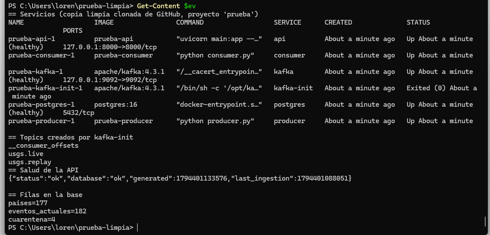 |
| Filtros del panel (Kamchatka) | 1.315 eventos entre el 29 de julio y el 1 de agosto de 2025, con el panel desplegado en Netlify | 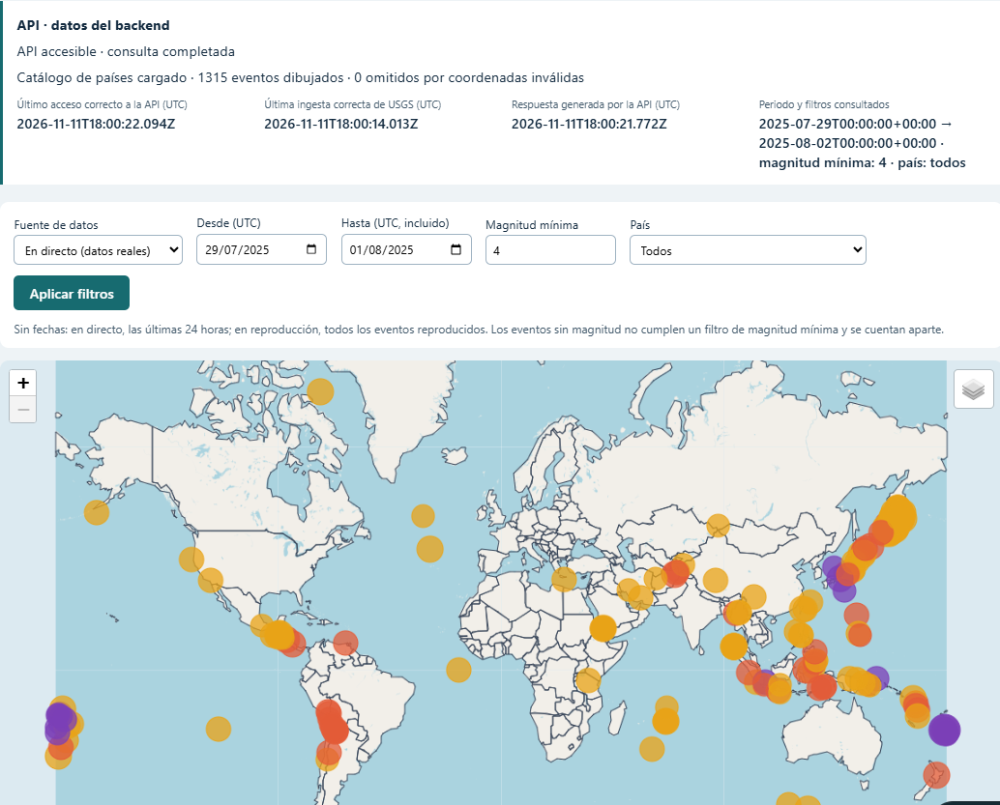 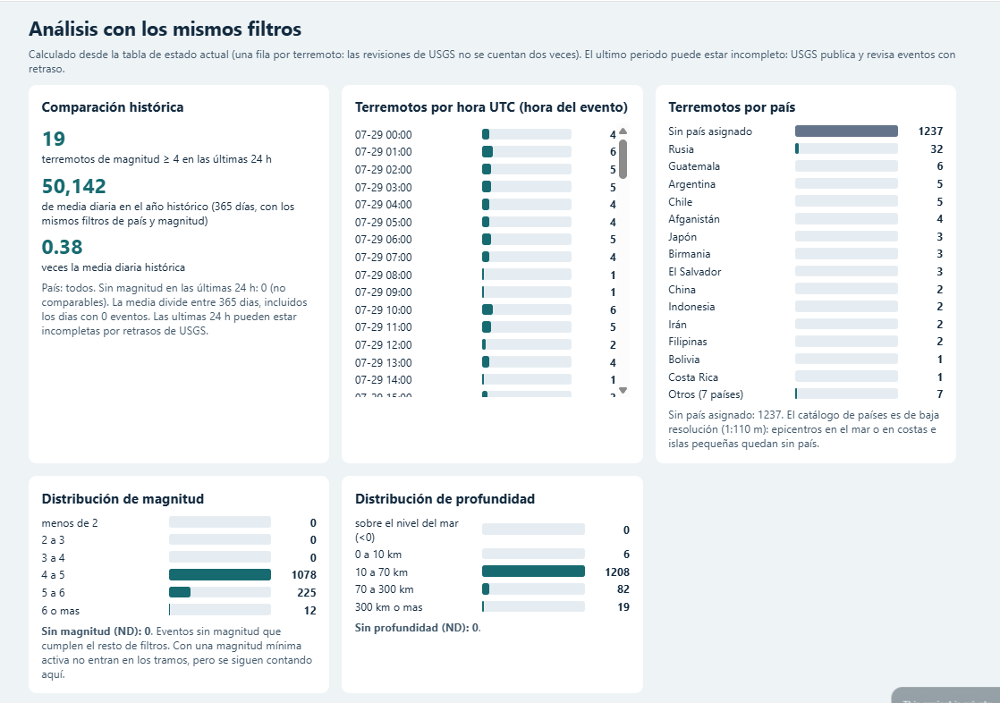 |
| Funcionamiento continuo 24 h | 25 h seguidas sin reinicios de servicios ni suspensiones del equipo; `api`, `kafka` y `postgres` en `healthy`; la API responde por el túnel | [`prueba_24h_inicio.txt`](evidencias/prueba_24h_inicio.txt) · [`prueba_24h_fin.txt`](evidencias/prueba_24h_fin.txt) · 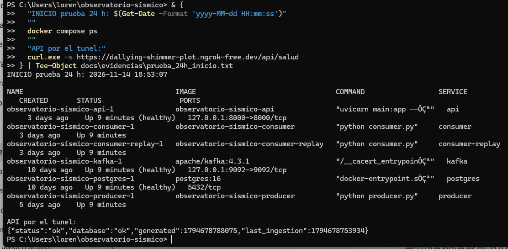 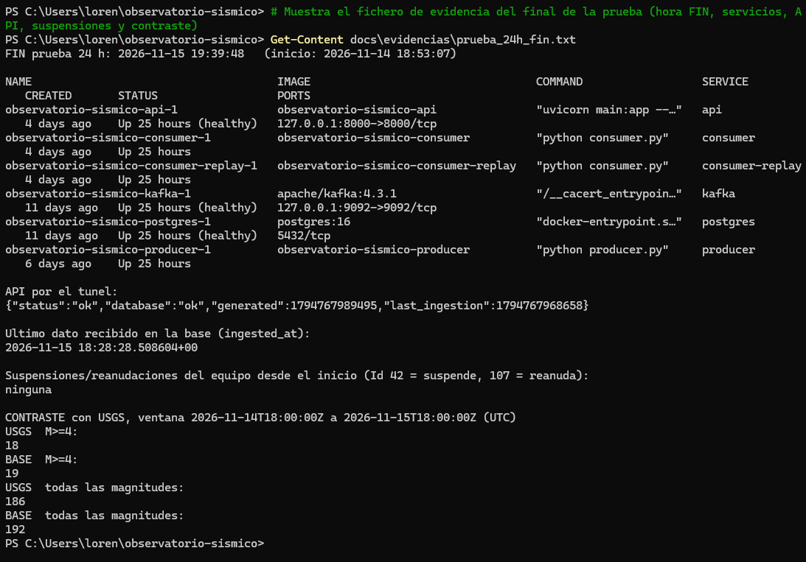 |
| Contraste con USGS (ventana de 24 h) | 0 eventos ausentes de 186; 6 de más (3 %): 1 eliminado por USGS y 5 duplicados entre redes | [`prueba_24h_diagnostico_ids.txt`](evidencias/prueba_24h_diagnostico_ids.txt) · [`prueba_24h_gemelos.txt`](evidencias/prueba_24h_gemelos.txt) ·  |

**Funcionamiento continuo.** El sistema estuvo en marcha 25 horas seguidas (del 14 de noviembre a las 18:53 al 15 de noviembre a las 19:39), sin reinicios de servicios ni suspensiones del equipo (registro de eventos de Windows, Id 42 y 107: «ninguna»), con `api`, `kafka` y `postgres` en estado `healthy` y la API respondiendo a través del túnel. Para ello el portátil se dejó enchufado, con la suspensión y la hibernación desactivadas y las actualizaciones de Windows pausadas.

Pruebas adicionales: la API responde **503** explícito si falla la base de datos y se recupera sola ([captura](img/api-salud-503-y-recuperacion.png)); el panel funciona desde un móvil con datos móviles (`netlify-movil-datos-moviles1/2/3.jpeg`); y CORS estaba mal configurado al principio y se corrigió con el origen exacto de Netlify ([captura del error](img/netlify-error-cors.png)).

Nota sobre la prueba de reglas de versiones en SQL (`prueba-reglas-version-sql.png`): **reproduce la regla en SQL**; la prueba con el consumidor real es la de `pruebas_basicas.txt` y la de la reproducción.

---

## 9. Reflexión, limitaciones y mejoras

**Lo que funciona bien.** Reiniciar cualquier pieza no duplica ni pierde datos (clave Kafka, offset confirmado tras la transacción y escritura idempotente); las revisiones se tratan con comparación de versiones, no solo con el orden; y la reproducción histórica se aísla por completo.

**Lo que aprendí que no esperaba.**
- El árbol espacial **no** aceleró la asignación de países con solo 177 polígonos.
- Los datos sintéticos subestiman el espacio real casi diez veces: 140 bytes por fila frente a 1.424.
- Mi primera medida de latencia (803 min) era engañosa: medía las paradas del equipo, no la tubería. Cambiarla por ventanas de llegada la hizo útil.
- Un ranking por países basado en un catálogo de baja resolución dice más del catálogo que de los países.
- Comparar solo recuentos con la fuente no basta: mi primer contraste mostraba la mitad de la historia, y fue comparar identificadores lo que reveló los 6 eventos de más. Además, mi primera explicación (los tipos de evento) resultó equivocada; la descarté al comprobarla.

**Limitaciones.**
- Sin el equipo, los contenedores y el túnel encendidos no hay datos nuevos (se evalúa el tratamiento del fallo, no la disponibilidad 24/7).
- Tras una parada de más de 24 h, el hueco se recupera con el catálogo histórico; el procedimiento está documentado, no automatizado.
- **No se reconcilian los eventos eliminados o fusionados por USGS.** USGS puede eliminar un evento, o quedarse con un solo identificador cuando dos redes registran el mismo terremoto; el sistema no lo detecta. Medido en una ventana de 24 h: 6 de 192 eventos (3 %) estaban en la base y ya no figuraban en USGS (sección 2.4). Mejora propuesta: revisar periódicamente los eventos recientes contra USGS, incluyendo los eliminados, y marcar los que desaparecen.
- Un solo broker y una sola base de datos: sin alta disponibilidad.
- La API es de solo lectura y sin autenticación; CORS no es autenticación.
- Medidas de rendimiento con una sola ejecución por tamaño y caché caliente.
- Las medidas de latencia y consumo se hicieron con muestras pequeñas.

**Mejoras propuestas, por prioridad.**
1. Catálogo de países de mayor resolución o asignación para zonas marítimas (reduce el 75 % sin país).
2. Registrar la hora de cada consulta con cada evento nuevo, para medir la latencia de forma directa.
3. Automatizar la recuperación de huecos de más de 24 h.
4. Revisar los índices que no se midieron (`pais_adm0_a3` y `mag`) con `EXPLAIN`; el de magnitud tiene poca utilidad en un histórico de M ≥ 4.
5. Compresión HTTP en la API y refresco adaptativo en el panel.
6. Particionado por mes y un tamaño de fila más contenido si el volumen crece.

---

## 10. Una decisión técnica propia

**Decisión:** los terremotos cuyo epicentro no cae dentro de ningún país se guardan como **«Sin país asignado»** (valor `NULL`), en lugar de atribuirlos al país más cercano o deducir el país del texto que escribe USGS.

**Por qué.** El catálogo de países tiene baja resolución (1:110 m, 177 entidades) y la mayoría de los terremotos ocurren en el mar. De los 19.287 terremotos de la base, 14.515 (el **75,26 %**) no caen en ningún polígono. Asignarlos al país más cercano habría dado una tabla completa pero falsa: un terremoto a 300 km de la costa de Japón no es «de Japón» en los datos. Prefiero un dato honesto con un hueco que un dato completo con errores.

**Cómo funciona.** El consumidor comprueba con un cálculo geométrico (punto en polígono) si las coordenadas del terremoto están dentro de algún país. Si lo están, guarda el código del país; si no, deja el campo vacío. El país nunca se deduce del texto `place`. La API permite filtrar los que no tienen país con `country_id=NONE`.

**Cómo se comprobó.**
- Contra el texto de USGS: en Etiopía, Chile, Indonesia y Argentina el país asignado coincide con lo que dice `place` en el 96–99 % de los casos (sección 3.6).
- Con un evento marítimo de prueba (`test-E2`): queda sin país y permanece en el análisis (sección 8).
- En el análisis (conclusión 4, sección 5): el 78,4 % de los terremotos de 2025 queda sin país, y por eso el ranking por países no mide qué país tiene más terremotos, sino cuáles caen dentro de sus polígonos.

**Consecuencia asumida.** Las cifras por país no son un ranking de peligrosidad y el análisis lo avisa. Mejora propuesta: un catálogo más detallado (1:10 m) o añadir zonas marítimas.

**Alternativas descartadas.**
- Asignar el país más cercano: inventa datos.
- Deducir el país del texto `place`: es texto libre y no siempre incluye un país.
- Descartar los eventos sin país: se perdería el 75 % de los datos.

---

## 11. Uso de IA

> **Declaración de uso de IA:** durante todo el proyecto he usado **Claude** (Anthropic) como asistente técnico y tutor: me ayudó con la arquitectura, el código y los borradores de la documentación. Yo ejecuté y comprobé cada paso en mi equipo, hice las capturas, tomé las decisiones de alcance y soy responsable de lo entregado. Las cifras proceden de ejecuciones reales (ficheros en `docs/evidencias/`), salvo las marcadas como suposición (S) o estimación.
