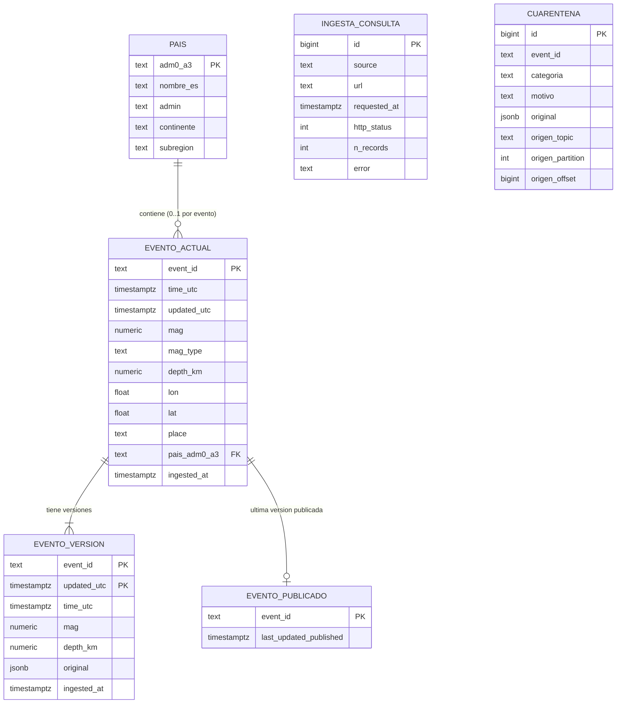

# Modelo de datos, diccionario y procedencia

Este documento recoge el **modelo conceptual, lógico y físico**, el **diccionario de datos**, la **justificación de los índices** y el **registro de consultas y procedencia** del Observatorio de actividad sísmica. Todas las cifras proceden de las evidencias del repositorio (`docs/evidencias/`); cuando algo es una suposición o no se ha medido, se dice.

## 1. Modelo conceptual

Cinco ideas del negocio, sin pensar todavía en tablas:

| Entidad | Qué es |
|---|---|
| **Terremoto** | Un fenómeno sísmico identificado por el `id` de USGS. Es el hecho que se analiza. |
| **Versión** | Cada vez que USGS revisa un terremoto (cambia magnitud, ubicación o fecha) nace una versión nueva con su fecha `updated`. |
| **País** | Entidad del catálogo Natural Earth. Un terremoto pertenece a 0 o 1 países (0 = «Sin país asignado»). |
| **Consulta** | Cada petición hecha a USGS (feed de 24 h o catálogo histórico), con su resultado. |
| **Rechazo** | Registro recibido que no puede tratarse como terremoto, conservado con su motivo y su original. |

Relaciones: un terremoto tiene **1..N versiones**; la versión más reciente es el **estado actual**; un terremoto pertenece a **0..1 país**; un rechazo se refiere a un mensaje de Kafka concreto (topic, partición y offset).

## 2. Modelo lógico



**Grano** (qué representa una fila):

| Tabla | Una fila es… | Clave primaria |
|---|---|---|
| `evento_actual` | el estado actual de un terremoto | `event_id` |
| `evento_version` | una versión de un terremoto | `(event_id, updated_utc)` |
| `pais` | una entidad del catálogo geográfico | `adm0_a3` |
| `evento_publicado` | la última versión que el productor publicó en Kafka | `event_id` |
| `ingesta_consulta` | una petición a USGS | `id` |
| `cuarentena` | un mensaje rechazado | `id` (único también por origen Kafka) |

**Decisiones de diseño**

- **`evento_actual` es la tabla de análisis.** Tiene una fila por terremoto, así que las revisiones de USGS no se cuentan dos veces: las agregaciones se calculan desde aquí, no incrementando contadores por mensaje.
- **`evento_version` conserva el historial y el original** (`original` en JSONB), sin sobrescribir nunca una versión posterior.
- **Dimensión país:** tabla propia (`pais`) cargada desde el catálogo. El país se calcula con punto en polígono, **nunca** leyendo el texto de `place`. «Sin país asignado» es `pais_adm0_a3 IS NULL`: se conserva en el análisis y no se atribuye al país más cercano.
- **Dimensión fecha:** no hay tabla de fechas. Las ventanas de una hora UTC se obtienen con `date_trunc('hour', time_utc, 'UTC')`. Motivo: evita mantener una tabla auxiliar (8.760 filas por año) para algo que PostgreSQL resuelve al consultar. Contrapartida: cada consulta recalcula la ventana; con los volúmenes medidos (ver `docs/evidencias/rendimiento.md`) el coste es despreciable.
- **Tiempo de ocurrencia y de procesamiento separados:** `time_utc` (cuándo ocurrió), `updated_utc` (última revisión según USGS) e `ingested_at` (cuándo lo guardamos).
- **Esquema `replay`:** copias de `evento_actual`, `evento_version` y `cuarentena` (`CREATE TABLE … LIKE public.x INCLUDING ALL`) para la reproducción histórica. Así la reproducción nunca se mezcla con los datos reales. La tabla `pais` se comparte (el consumidor de replay usa `search_path = replay, public`).

## 3. Modelo físico (SQL)

SQL real de las tablas, tal como queda en PostgreSQL 16:

```sql
CREATE TABLE pais (
    adm0_a3    text PRIMARY KEY,
    nombre_es  text NOT NULL,
    admin      text,
    continente text,
    subregion  text
);

CREATE TABLE evento_actual (
    event_id     text PRIMARY KEY,
    time_utc     timestamptz NOT NULL,
    updated_utc  timestamptz NOT NULL,
    mag          numeric(4,2),
    mag_type     text,
    depth_km     numeric(8,3),
    lon          double precision NOT NULL,
    lat          double precision NOT NULL,
    place        text,
    pais_adm0_a3 text REFERENCES pais(adm0_a3),
    ingested_at  timestamptz NOT NULL DEFAULT now(),
    CHECK (lon BETWEEN -180 AND 180 AND lat BETWEEN -90 AND 90)
);

CREATE TABLE evento_version (
    event_id     text NOT NULL,
    updated_utc  timestamptz NOT NULL,
    time_utc     timestamptz NOT NULL,
    mag          numeric(4,2),
    mag_type     text,
    depth_km     numeric(8,3),
    lon          double precision,
    lat          double precision,
    place        text,
    pais_adm0_a3 text,
    original     jsonb NOT NULL,
    ingested_at  timestamptz NOT NULL DEFAULT now(),
    PRIMARY KEY (event_id, updated_utc)
);

CREATE TABLE evento_publicado (
    event_id               text PRIMARY KEY,
    last_updated_published timestamptz NOT NULL
);

CREATE TABLE ingesta_consulta (
    id           bigserial PRIMARY KEY,
    source       text NOT NULL,
    url          text NOT NULL,
    requested_at timestamptz NOT NULL,
    http_status  integer,
    n_records    integer,
    error        text
);

CREATE TABLE cuarentena (
    id               bigserial PRIMARY KEY,
    event_id         text,
    categoria        text NOT NULL,
    motivo           text NOT NULL,
    original         jsonb NOT NULL,
    received_at      timestamptz NOT NULL DEFAULT now(),
    origen_topic     text,
    origen_partition integer,
    origen_offset    bigint
);

-- Índices
CREATE INDEX idx_evento_actual_time ON evento_actual (time_utc);
CREATE INDEX idx_evento_actual_pais ON evento_actual (pais_adm0_a3);
CREATE INDEX idx_evento_actual_mag  ON evento_actual (mag);
CREATE UNIQUE INDEX ON cuarentena (origen_topic, origen_partition, origen_offset);
```

### Escritura idempotente (el núcleo del modelo)

```sql
-- 1) Guardar la versión recibida; si ya existía exactamente esa versión, no hace nada
INSERT INTO evento_version (...) VALUES (...)
ON CONFLICT (event_id, updated_utc) DO NOTHING;

-- 2) Actualizar el estado actual SOLO si la versión recibida es más reciente
INSERT INTO evento_actual (...) VALUES (...)
ON CONFLICT (event_id) DO UPDATE SET ...
WHERE EXCLUDED.updated_utc > evento_actual.updated_utc;
```

Ambas sentencias van en **una transacción** y el offset de Kafka se confirma **después** de ella. Consecuencias (todas comprobadas en las pruebas de aceptación):

| Situación | Resultado |
|---|---|
| Mismo mensaje dos veces | Ninguna fila nueva: no aumenta el recuento |
| Versión posterior | Cambia `evento_actual`; la anterior queda en `evento_version` |
| Versión antigua que llega tarde | Se guarda en `evento_version`; **no** sustituye al estado actual |
| Reinicio del consumidor | Reanuda desde el último offset confirmado sin duplicar efectos |

## 4. Justificación de los índices

| Índice | Para qué consulta | Evidencia |
|---|---|---|
| `evento_actual (event_id)` — clave primaria | Localizar un terremoto y decidir el *upsert* | Prueba sintética con 1.000.000 de filas: 21,8 ms sin índice frente a 0,08 ms con índice (×270) |
| `idx_evento_actual_time (time_utc)` | Ventanas horarias, rango de fechas y «últimas 24 h» | Sintética con 1 M de filas: 16,8 ms → 0,96 ms (×17). El plan pasó de *Seq Scan* a *Index Only Scan*. Esa prueba solo pedía `time_utc` y un recuento; una consulta que lea más columnas no siempre podrá usar *Index Only Scan* |
| `idx_evento_actual_pais (pais_adm0_a3)` | Filtro y recuento por país | **No medido** por separado en este proyecto |
| `idx_evento_actual_mag (mag)` | Filtro de magnitud mínima | **No medido.** Utilidad limitada: el histórico de 2025 se descargó con magnitud ≥ 4, así que ese filtro no descarta casi nada en esos datos. Candidato a revisar con `EXPLAIN` |
| `evento_version (event_id, updated_utc)` — clave primaria | Buscar versiones de un evento (el prefijo `event_id` también sirve) y detectar versiones repetidas | Misma lógica que la clave de `evento_actual` |
| Único en `cuarentena (origen_topic, origen_partition, origen_offset)` | Que reentregar el mismo mensaje no duplique el rechazo | Prueba de reinicio del consumidor |

Coste de los índices (medido con datos sintéticos, 1 M de filas): tabla 88,0 MB e índices 51,5 MB; crearlos tardó 0,5 s. Con las filas reales el espacio por terremoto es mayor (1.424 bytes frente a ~140 de la prueba sintética), porque `evento_version` guarda el JSON original. Ver `docs/evidencias/costes_almacenamiento.md`.

## 5. Diccionario de datos

### 5.1 Campos de USGS y cómo se transforman

| Campo USGS | Columna | Tipo | Unidad / formato | ¿Opcional? | Transformación |
|---|---|---|---|---|---|
| `id` | `event_id` | texto | identificador USGS | No | Ninguna. Es la clave del evento y la clave de Kafka |
| `properties.time` | `time_utc` | timestamptz | USGS: milisegundos desde Unix epoch | No | Convertido a fecha UTC |
| `properties.updated` | `updated_utc` | timestamptz | milisegundos desde Unix epoch | No | Convertido a fecha UTC |
| `properties.mag` | `mag` | numeric(4,2) | magnitud (adimensional; el tipo depende de `mag_type`) | **Sí** | Los nulos se conservan como nulos (se muestran como ND). Se rechaza si no es numérica o `abs(mag) ≥ 100`. Una magnitud negativa **no** es error |
| `properties.magType` | `mag_type` | texto | p. ej. `ml`, `mb`, `mww` | Sí | Ninguna |
| `geometry.coordinates[0]` | `lon` | double | grados, WGS84 (EPSG:4326), −180 a 180 | No | Se rechaza si no es finita o está fuera de rango |
| `geometry.coordinates[1]` | `lat` | double | grados, WGS84, −90 a 90 | No | Idem |
| `geometry.coordinates[2]` | `depth_km` | numeric(8,3) | kilómetros | Sí | Nulo se conserva. Una profundidad negativa (foco sobre el nivel del mar) **no** se rechaza |
| `properties.place` | `place` | texto | descripción libre | Sí | Ninguna. **No** se usa para asignar país |
| `properties.type` | — | texto | `earthquake`, `quarry blast`, `explosion`, … | No | Solo se aceptan `earthquake`; el resto va a cuarentena (categoría `excluido`) |
| *(calculado)* | `pais_adm0_a3` | texto | código `ADM0_A3` de Natural Earth | Sí (nulo = «Sin país asignado») | Punto en polígono con Shapely/STRtree. Con varias coincidencias (frontera) gana el menor `ADM0_A3` |
| *(sistema)* | `ingested_at` | timestamptz | UTC | No | Momento en que se escribió en la base |
| *(original)* | `original` | jsonb | GeoJSON de la feature tal como llegó | No | Sin modificar |

### 5.2 Tablas auxiliares

| Tabla.columna | Significado |
|---|---|
| `evento_publicado.last_updated_published` | `updated` de la última versión que el productor publicó y Kafka confirmó. Evita republicar lo ya publicado |
| `ingesta_consulta.source` | Origen de la petición: `usgs_all_day` (feed en vivo) o `usgs_historico` |
| `ingesta_consulta.http_status`, `error` | Resultado de la petición; si falló, el motivo |
| `ingesta_consulta.n_records` | Número de registros que devolvió |
| `cuarentena.categoria` | `excluido` (no es un terremoto), `invalido` (datos imposibles) o `mensaje_invalido` (JSON ilegible o sin evento) |
| `cuarentena.motivo` | Texto con la razón concreta |
| `cuarentena.original` | Mensaje original completo, sin modificar |
| `cuarentena.origen_*` | Topic, partición y offset de Kafka del mensaje rechazado |

### 5.3 Reglas de validación del consumidor

| Regla | Si no se cumple |
|---|---|
| JSON legible con evento y `properties` | Cuarentena `mensaje_invalido` |
| `id` presente y no vacío | Cuarentena `mensaje_invalido` |
| `type == "earthquake"` | Cuarentena `excluido`, con el tipo en el motivo |
| `time` y `updated` enteros (ms) y convertibles a fecha | Cuarentena `invalido` |
| Geometría `Point` con al menos longitud y latitud | Cuarentena `invalido` |
| Longitud y latitud numéricas finitas y en rango | Cuarentena `invalido` |
| Profundidad numérica si existe | Cuarentena `invalido` |
| Magnitud numérica y de módulo < 100 si existe | Cuarentena `invalido` |

## 6. Registro de consultas y procedencia

| Fuente | Qué se obtiene | Cómo | Dónde queda el registro |
|---|---|---|---|
| **USGS feed `all_day`** | Terremotos de las últimas 24 h (la respuesta contiene toda la ventana cada vez) | GET cada 60 s (`POLL_SECONDS`) a `https://earthquake.usgs.gov/earthquakes/feed/v1.0/summary/all_day.geojson` | Tabla `ingesta_consulta` (`source = usgs_all_day`). Medido: 665 consultas entre 2026-11-05 16:48 y 2026-11-11 10:39 UTC, 0 con error; 10 huecos de más de 5 min por apagados y reinicios. Cada descarga pesa unos 145 KB |
| **USGS catálogo histórico (FDSN)** | Año 2025, mundial, `minmagnitude=4`, `eventtype=earthquake`, un fichero por mes | `python historico.py descargar` (meses; si una consulta superase 20.000 resultados, se subdivide sin truncar). Se deduplican los eventos compartidos entre intervalos | Ficheros mensuales en `historico/datos/` (no van a Git); **manifiesto** `historico/manifest_2025.json` (consultas, fecha de extracción, nº de registros y huella SHA-256 de cada fichero); filas en `ingesta_consulta` (`source = usgs_historico`). Resultado (según el manifiesto): 18.302 registros brutos, 18.302 únicos y 0 duplicados entre intervalos; ningún mes superó el límite de 20.000 resultados |
| **Natural Earth 110m** | 177 entidades con polígonos | Copia entregada en `frontend/public/datos/paises.geojson` | Fuente, licencia y huella en `FUENTES-Y-LICENCIAS.md` |
| **Reproducción histórica** | 40 eventos reales de 2025 + 3 casos controlados sintéticos | `compose.replay.yaml` (`replay.py`) | Esquema `replay` y topic `usgs.replay`; cada mensaje lleva `mode: replay` y `replay_case`. Evidencias: `docs/evidencias/replay_envio.txt` y `prueba_replay.txt` |

**Procedimiento para regenerar los datos originales** (no están en Git):

```powershell
# 1) Levantar los servicios
docker compose up --build -d
# 2) Descargar el histórico (una sola vez; si los ficheros existen, se reutilizan) y registrar las consultas
docker compose -f compose.yaml -f compose.tools.yaml run --rm historico python /historico/historico.py descargar
# 3) Publicar el histórico en Kafka (el consumidor lo escribe en la base)
docker compose -f compose.yaml -f compose.tools.yaml run --rm historico python /historico/historico.py publicar
```

> Nota: la fecha exacta de extracción de cada mes está en `historico/manifest_2025.json`. El histórico es una **instantánea del catálogo en esa fecha**, no un registro de todas las revisiones pasadas.

### Limitaciones de procedencia

- El feed `all_day` solo cubre 24 h. Tras una parada superior a 24 h, el hueco se recupera con el catálogo histórico (consulta por intervalos de fecha) y se publica por el mismo camino.
- Un evento que deja de aparecer en el feed **no** se considera borrado: puede haber envejecido más allá de las 24 h. La reconciliación de eventos eliminados o fusionados fuera del feed queda fuera del alcance mínimo (ampliación documentada).
- El catálogo de países es de baja resolución (1:110 m): el 78,4 % de los terremotos de M ≥ 4 de 2025 queda «Sin país asignado» (epicentros marinos y costas). Ver `docs/evidencias/analisis_2025.md`.
